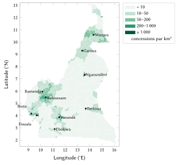
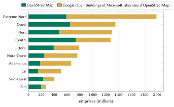
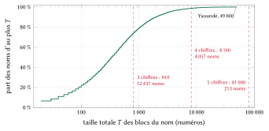
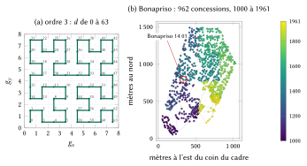
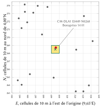

# Introduction

## Le problème

Une adresse indique à un inconnu où se rendre. Au Cameroun, la plupart des domiciles n’en ont aucune qu’un inconnu puisse utiliser. La fiche d’adressage de l’Union postale universelle pour le pays ne comporte pas de ligne de code postal : son adresse type se compose d’un nom, de « BP 6000 » et de « YAOUNDÉ » [@upu2002cameroon]. Le courrier est distribué en boîte postale (BP), qui désigne un guichet et non un logement ; le quotidien national l’écrivait sans détour en 2024 : la boîte postale « n’est pas considérée comme une adresse réelle » [@nsangou2024adresse]. En novembre 2024, la presse a rapporté que le gouvernement avait créé des codes postaux couvrant l’ensemble du territoire, attribués par commune et délivrés par l’application de Campost et FindMe [@njoya2024campost; @eyango2024campost]. Deux ans plus tard, aucune liste, aucun format ni aucun exemple de ces codes n’est public.

Yaoundé et Douala ont commencé à codifier leurs rues et à numéroter leurs portes en 1992, dans le cadre du deuxième Projet de développement urbain financé par la Banque mondiale [@farvacque2005; @batamag2017douala]. Ce travail a produit les noms de rues codifiés que l’on voit encore dans la capitale (« Rue 1.014 ») et une numérotation métrique des portes dans une partie des deux villes. Pourtant, en 2019, moins de 15 % des voies de Douala portaient un nom [@tsayid2019rues], et Njoh décrit l’effort national comme limité aux deux plus grandes villes et à la dénomination plutôt qu’à l’adressage physique [@njoh2010toponymic]. Ailleurs, et pour la plupart des domiciles de ces villes mêmes, on indique le chemin par le quartier et un repère : « Bonapriso, derrière la boulangerie ».

Les conséquences sont banales et coûteuses. Une livraison ou une course de moto-taxi s’achève par un appel téléphonique ; une ambulance atteint le quartier puis cherche le portail ; une banque, un employeur ou une école demande une adresse qu’on ne sait pas écrire ; une famille à l’étranger envoie argent et colis à une description. Une même concession, derrière un même portail, abrite plusieurs ménages et des chambres en location, et dans les villages de la forêt et du Nord, les cases s’alignent le long de pistes sans nom.

L’adressage classique nomme les rues, numérote les portes et tient un fichier des adresses [@farvacque2005]. Il est efficace là où il est achevé et entretenu, mais il est lent et repose sur des plaques qu’il faut poser et maintenir. Dans une revue de la Banque mondiale portant sur 21 villes africaines, son coût moyen était de 5,7 dollars US par porte adressée, aux prix de 2005 [@farvacque2005].

## Contribution

Cet article présente un modèle national d’adressage pour le Cameroun et le registre qui en est issu. Ses apports sont les suivants :

1. **Un code que l’on peut dire et retenir.** Un code est le nom d’un lieu que les habitants emploient déjà, suivi d’un numéro d’au plus cinq chiffres, lu par paires comme un numéro de téléphone : *Bonapriso 14 01*.
2. **Une unicité nationale sans contexte.** Chaque nom possède une plage nationale de numéros, découpée en blocs figés, un par zone qui porte ce nom ; un code désigne ainsi une seule concession dans tout le pays, sans ville, sans département et sans position de l’appareil.
3. **Localité et croissance.** Les numéros suivent une courbe de Hilbert sur chaque zone, laissent des intervalles pour les nouvelles constructions et conservent une réserve : des voisins ont des numéros voisins, et les nouvelles concessions s’insèrent entre eux.
4. **L’intégrité pour les systèmes.** Une forme machine porte un chiffre de contrôle de Damm calculé sur le nom, l’arrondissement, la zone et le numéro ; il détecte toute erreur sur un chiffre et toute transposition de deux chiffres adjacents.
5. **Le respect des adresses officielles.** Lorsqu’une rue codifiée par la commune longe la concession, elle est affichée en premier ; les numéros de porte communaux et les codes de Campost occupent des champs réservés dès qu’ils sont communiqués ou publiés.
6. **Une couverture complète et ouverte.** Les 7 243 272 concessions recensées dans le pays ont reçu un code le 21 octobre 2026. La spécification, le moteur de référence, le registre et un serveur prêt à déployer sont publiés sous licences ouvertes [@nways2026repo].
7. **Évaluation et impact.** Nous mesurons les propriétés des codes émis et estimons, sous des hypothèses explicites, leurs effets pour les citoyens, la logistique, les services d’urgence et l’administration.

## Plan de l’article

La section 2 passe en revue les systèmes postaux, d’adressage et fonciers existants au Cameroun ainsi que la pratique internationale. La section 3 décrit les données. La section 4 expose le modèle règle par règle, avec pour chaque formule un exemple chiffré sur un code réel. La section 5 décrit la mise en œuvre et la section 6 l’évaluation. La section 7 présente les conceptions envisagées puis écartées, mesures à l’appui. Les sections 8 à 11 estiment les bénéfices pour les citoyens, la logistique et le commerce, les services d’urgence et l’administration. La section 12 traite de la vie privée, de la sécurité et de la gouvernance, la section 13 des limites, et la section 14 conclut.

# Contexte et travaux connexes

## Territoire, population et langues

Le Cameroun compte dix régions, 58 départements et 360 arrondissements, chacun correspondant au territoire d’une commune ; quatorze communautés urbaines regroupent les communes d’arrondissement des grandes villes, comme Douala I à VI et Yaoundé I à VII. La loi n° 2019/024 du 24 décembre 2019 portant Code général des collectivités territoriales décentralisées confère un statut spécial aux régions anglophones du Nord-Ouest et du Sud-Ouest [@loi2019cgctd]. Le français et l’anglais sont les langues officielles, et plus de 250 langues sont parlées ; le pidgin camerounais, le fulfulde, l’ewondo et le duala servent de langues véhiculaires dans leurs régions [@echu2004language]. Le dernier recensement publié, le troisième, dénombrait 17 463 836 habitants en 2005 ; le quatrième a achevé sa collecte le 15 septembre 2026 sans avoir encore publié de résultats, et la projection du BUCREP avant le dénombrement dépassait 28,8 millions [@kimeng2026census].

## La poste et la boîte postale

La fiche de l’UPU pour le Cameroun donne une adresse type composée d’un numéro de boîte et d’une ville, sans code postal [@upu2002cameroon]. Campost et l’entreprise privée FindMe ont signé un partenariat le 1^er^ novembre 2024 ; FindMe opérait au Cameroun depuis juillet 2024, et son adresse prend la forme « numéro d’occupation, nom de rue, code postal, ville » [@njoya2024campost]. La presse a rapporté que le Cameroun « ne disposait pas de codes postaux pour ses communes » et que ces codes sont désormais attribués par commune [@eyango2024campost]. Une adresse certifiée, le plan de localisation postale (PLP), coûte 2 000 FCFA [@nsangou2024adresse]. Au 21 octobre 2026, ni le site de Campost ni aucun document public ne présentait de liste, de format ou d’exemple des codes communaux [@campost2026].

## Rues codifiées et numéros de porte à Yaoundé et à Douala

La revue de la Banque mondiale décrit en détail le programme des deux villes [@farvacque2005]. Chaque agglomération a été divisée en six grandes zones ; une rue est identifiée par deux nombres, la zone et un numéro d’ordre (la rue 4.15 est la quinzième rue de la zone 4) ; les portes sont numérotées selon le système métrique, pairs et impairs de part et d’autre de la voie ; et l’enquête relevait le nom de l’occupant, l’usage de la parcelle et ses références cadastrales. Une circulaire présidentielle sur la dénomination des rues remonte à 1971. Ce programme explique la forme des adresses en usage aujourd’hui : les bureaux des Nations unies à Yaoundé donnent leur adresse sous la forme d’un numéro de porte sur une rue codifiée, d’un nom d’immeuble et d’un quartier (« Rue 1794, Ekoudou, Bastos ») [@un2026contact]. OpenStreetMap nomme 8 625 rues des deux villes, dont 7 531 avec leur code. Nous n’avons trouvé ni service public de recherche ni données ouvertes sur les numéros de porte de l’une ou l’autre ville.

## Le foncier, la cartographie et l’absence de registre d’adresses

Les titres fonciers et les plans cadastraux relèvent du ministère des Domaines, du Cadastre et des Affaires foncières (MINDCAF) ; ils identifient un terrain, non le portail où s’arrête un livreur, et la plupart des domiciles n’en ont pas. La référence géodésique du cadastre est passée du système Douala 1948 à Manoca 1962 / UTM zone 32N [@epsg2215]. Un projet de la Banque mondiale approuvé en mai 2025 porte sur l’administration foncière et les infrastructures urbaines, non sur l’adressage [@worldbank2025cameroon]. L’Institut national de cartographie (INC) est le principal producteur de cartes ; selon le rapport national présenté au Groupe d’experts des Nations unies pour les noms géographiques, les activités toponymiques de 2023–2024 « restent contrariées » par la vie chère et par l’insécurité dans le Nord-Ouest et le Sud-Ouest [@simeu2025ungegn]. Nous n’avons trouvé ni registre national des adresses, ni loi nationale sur l’adressage, ni géoportail national des adresses.

## La pratique internationale

La norme S42 de l’UPU définit la structure et la présentation des adresses postales de chaque pays [@upuS42], et la norme ISO 19160-1 propose un modèle conceptuel de l’adresse [@iso19160]. Toutes deux décrivent des adresses ; aucune ne les crée là où les rues n’ont pas de nom. Le rapport de l’UPU *Addressing the World* soutient qu’une adresse pour chaque logement est une condition préalable des services postaux, financiers et civils [@upu2012addressing]. Le programme d’adressage des villes africaines de la Banque mondiale, qui comprenait Yaoundé et Douala, fait référence pour la pratique classique [@farvacque2005]. Plusieurs pays de la région ont adopté des systèmes nationaux d’adresses numériques fondés sur des codes de grille ; celui du Ghana, introduit en 2017, dérive un code de la maille où se trouve le lieu [@bokpe2017ghana].

## Autres systèmes de codes

Les codes de grille, tels qu’Open Location Code (Plus Codes), attribuent à tout point de la Terre un code court calculé à partir de sa latitude et de sa longitude [@olc]. Ils fonctionnent hors ligne, mais leurs codes mêlent lettres et chiffres, comportent un signe plus et n’évoquent rien pour un habitant : « 6FR5JCH8+5QV » se dicte mal en français, en anglais ou en pidgin, et personne ne le retient. Les systèmes propriétaires fondés sur des mots ne sont pas ouverts. Aucun de ces deux types ne désigne un domicile en propre : deux portails d’une même concession ont deux codes, et un même code peut couvrir deux domiciles. Le modèle présenté ici n’utilise une grille que pour les points qui ne sont pas des domiciles (section 4.10) et conserve, pour les domiciles, les noms que les habitants prononcent.

# Données et sources

## Limites administratives et lieux nommés

Les 360 arrondissements proviennent d’OpenStreetMap (niveau administratif 8), et les lieux nommés d’OpenStreetMap (ville, bourg, faubourg, quartier, voisinage, village, hameau et lieu-dit) ainsi que des lieux habités de GeoNames [@geofabrik2026cameroon; @haklay2008osm; @geonames]. Chaque arrondissement reçoit une clé de quatre caractères (YDE6 pour Yaoundé VI, DLA1 pour Douala I, BDA2 pour Bamenda II) et un indice figé de 0 à 359. La figure 1 représente les arrondissements selon la densité de concessions.

{width=92%}

## Emprises de bâtiments

Les emprises de bâtiments proviennent d’OpenStreetMap et, là où OpenStreetMap n’en contient pas, de Google Open Buildings [@sirko2021openbuildings] et des emprises mondiales de Microsoft [@microsoft2023footprints], toutes deux distribuées par la fondation Overture Maps [@overture2026buildings]. Une emprise de Google ou de Microsoft n’est retenue que si aucun bâtiment d’OpenStreetMap ne la chevauche. Les emprises de moins de 1 m² sont écartées, de même que 182 507 emprises situées hors du territoire. On obtient 9 293 569 emprises : 3 836 259 d’OpenStreetMap et 5 457 310 des deux autres jeux de données. L’emprise médiane mesure 51 m². La figure 2 montre les sources par région : OpenStreetMap est majoritaire dans le Centre, le Sud et le Sud-Ouest, tandis que les emprises détectées automatiquement dominent dans l’Extrême-Nord, où elles représentent 70 % du total.

{width=88%}

## Rues officielles, clôtures et portails

Nous tirons également d’OpenStreetMap les rues nommées de Yaoundé et de Douala avec leur code, les murs, clôtures et haies qui ferment les concessions (854 enclos cartographiés contenant des bâtiments) et les portails et entrées cartographiés. Chaque concession enregistre la rue officielle la plus proche dans un rayon de 30 m.

## Vérification des systèmes existants

Les systèmes existants ont été vérifiés du 17 au 21 octobre 2026 en ouvrant et en lisant chaque source ; le relevé complet, qui indique pour chaque source si elle a été lue ou seulement vue dans les résultats de recherche, figure dans `docs/existing-systems.md` du dépôt [@nways2026repo].

# Le modèle

## Les formes d’un code

Une concession possède plusieurs formes d’un même code, chacune destinée à un lecteur différent.

| Forme | Exemple | Utilisée par |
|:--|:--|:--|
| Retenue (écrite) | *Bonapriso 14 01*, dit « Bonapriso, quatorze, zéro un » | les personnes : à l’oral, au clavier, sur un colis |
| Cinq chiffres | *Mokolo 18 834*, dit « dix-huit, huit cent trente-quatre » | les noms les plus grands et les plus répétés |
| Trois chiffres | *Intendance 137*, dit « cent trente-sept » | les petites zones |
| Machine | CM-DLA1-015-1401-6 | applications, codes QR, partenaires ; le dernier chiffre est le contrôle |
| Bâtiment, entrée | CM-DLA1-015-1401-6.2/1 | un bâtiment de la concession ; l’un de ses portails |
| Point | CM-DLA1 E0449 N0268 | tout point : un étal, un champ, une place de marché |
| Officielle | Rue 1.014, Yaoundé | l’adresse de la commune, affichée en premier là où elle existe |

: Les formes d’un code. {#tbl:forms}

Soit $P$ le nom de plaque de la zone, $N$ le numéro à $n \in \{3,4,5\}$ chiffres, $Z$ la clé de l’arrondissement, $I$ l’indice à trois chiffres de la zone dans cet arrondissement et $c$ le chiffre de contrôle (section 4.9). Les deux formes principales sont

$$
\text{retenue} = P \;\sqcup\; g(N), \qquad
\text{machine} = \texttt{CM-}Z\texttt{-}I\texttt{-}N\texttt{-}c,
\tag{1}
$$

où $\sqcup$ désigne une espace et $g$ regroupe les chiffres comme on les prononce : $g(137) = \text{137}$, $g(1401) = \text{14 01}$, $g(18834) = \text{18 834}$. Un nom de plaque ne contient jamais de chiffre ; le numéro commence donc toujours au premier chiffre du texte.

## Unités et zones d’adressage

Une *zone d’adressage* est un lieu nommé d’un arrondissement : un lieu d’OpenStreetMap, ou un lieu habité de GeoNames sauf s’il se trouve à moins de 1 km d’un lieu d’OpenStreetMap de même nom. Un second lieu de même nom situé à moins de 300 m du premier est écarté. On obtient 24 213 zones, dont 23 208 contiennent des domiciles. Chaque emprise $f$ est rattachée au point de lieu le plus proche de son propre arrondissement $U(f)$ :

$$
a(f) = \operatorname*{arg\,min}_{a \in U(f)} \Big[ (\lambda_f - \lambda_a)^2 \cos^2 \varphi_f + (\varphi_f - \varphi_a)^2 \Big],
\tag{2}
$$

où $\lambda$ est la longitude et $\varphi$ la latitude, les égalités étant départagées par la clé de zone la plus basse. Chaque zone est figée à la première émission : sa clé, son bloc de numéros et son *cadre*, le rectangle englobant $(x_0, y_0, x_1, y_1)$ des centres de ses emprises, sur lequel ses numéros sont disposés. Yaoundé compte 307 zones et 346 523 concessions, Douala 267 zones et 410 644 concessions ; la plus grande zone, Alphonse (Carrefour Alphonse, Douala III), en regroupe 19 107. La figure 3 montre la répartition des tailles de zones.

{width=88%}

## Les noms de plaque

Un nom inscrit sur un portail, un colis ou prononcé au téléphone doit être court. Un nom de plaque $s$ est admissible lorsque

$$
\operatorname{ok}(s) \iff \lvert \operatorname{NFC}(s) \rvert \le 12 \;\wedge\; \lvert \operatorname{mots}(s) \setminus L \rvert \le 2 \;\wedge\; s \text{ ne contient aucun chiffre},
\tag{3}
$$

où $\lvert\cdot\rvert$ compte les caractères Unicode après composition canonique et $L$ est l’ensemble des articles et prépositions non comptés : $L_{\text{fr}} = \{$de, du, des, d, la, le, les, l, et, sur, en, au, aux, à$\}$ dans les 295 arrondissements francophones et $L_{\text{en}} = \{$of, the, and, on, at$\}$ dans les 65 arrondissements du Nord-Ouest et du Sud-Ouest, où les noms de plaque suivent l’usage anglais.

Un nom officiel qui ne satisfait pas l’équation (3) est raccourci par des étapes fixes, et l’on retient la première qui aboutit : le nettoyage (parenthèses ; les mots génériques Quartier, Carrefour, Lotissement, Cité, Village, Quarter, Layout, Junction : « Carrefour Intendance » devient *Intendance*) ; « Saint » devient « St » ; puis la suite de mots entiers la plus distinctive, retenue seulement si elle devance nettement les autres. Un mot n’est jamais coupé.

Les toponymes camerounais associent souvent un mot de repère au nom propre du lieu : « Carrefour Laboratoire Meka », « Mission Catholique Mokolo », « Place du Président Ahmadou Ahidjo ». La règle comporte donc une liste de 186 mots courants, français et anglais (*laboratoire, mission, catholique, président, cimetière, poteau, school, junction*…), considérés comme faibles : la forme courte conserve le nom propre (*Meka*, *Mokolo*, *Ahidjo*) et jamais le repère. Les mots des langues nationales qui font partie des noms (Ouro, Mayo, Hosséré, Djaouro, Nkol, Mvog, Elig) sont des noms, de même que les noms de peuples (Haoussa, Foulbé). Lorsque la seule forme courte possible contiendrait un chiffre, ne comporterait que des mots courants (« Vallée de la Mort » donnerait « Mort »), couperait une expression (« Yenga Sans » pour « Yenga Sans Famille ») ou désignerait une autre ville, la zone porte le nom de son arrondissement jusqu’à ce que la commune choisisse.

| Zones | Nombre |
|:--|--:|
| Nom de plaque identique au nom officiel | 22 024 |
| Débarrassé des mots génériques | 214 |
| Réduit aux mots distinctifs | 738 |
| Abrégé | 1 |
| Laissé au choix de la commune, avec des propositions | 1 236 |
| *dont encore au-delà de la limite de l’équation (3)* | *210* |
| Noms officiels de plus de 12 caractères ou de deux mots | 2 122 |

: Obtention des noms de plaque des 24 213 zones. {#tbl:plates}

Les 1 236 zones signalées à leur commune portent un nom de plaque provisoire ; 487 712 codes ont été émis sous un tel nom, que la commune peut modifier une fois. Le nom officiel demeure toujours un alias (1 773 alias sont conservés ; 37 sont écartés parce que deux noms de plaque les revendiquent) : saisir le nom officiel complet retrouve la même concession.

## La clé de nom

Deux graphies d’un même nom doivent conduire à la même plage. La clé d’un nom est la composition

$$
\kappa(s) = \sigma \circ \phi \circ \jmath \circ \alpha \circ \eta \circ \tau \circ \upsilon \circ \mu\,(s),
\tag{4}
$$

appliquée de droite à gauche : $\mu$ supprime les accents et $\upsilon$ passe en majuscules ; $\tau$ développe St et Ste en Saint et Sainte ; $\eta$ supprime un mot de tête (Q, Quartier, Quarter, Hameau, Village de) et $\alpha$ un article initial (le, la, les, the, l’) ; $\jmath$ retire tout caractère autre que A–Z et 0–9 ; $\phi$ ramène les variantes orthographiques courantes au Cameroun (tch et ch en c ; dj en j ; gh en g ; ph en f ; ck en k ; ou et w en u ; gu devant i ou e en g) ; et $\sigma$ écrit une seule fois une lettre doublée. Les chiffres ne sont jamais réduits : « Mile 22 » reste distinct de « Mile 2 ». Par construction, $\kappa$ ne peut que réunir des graphies, jamais scinder un nom en deux : Djoungolo et Joungolo, Tchinga et Chinga, Douala et Duala, Ekellé et Ekele partagent chacun une clé. Les 24 213 zones portent 17 240 noms de plaque ; 3 886 noms sont partagés par 10 859 zones, dont 30 zones nommées Adjap (l’une écrite Ajap), 27 Mélen, 27 Yaoundé (nom provisoire), 26 Akak et 24 Akom.

## Une plage nationale par nom

Chaque nom possède une plage nationale de numéros de longueur fixe : 100–999, 1000–9999 ou 10000–99999. Soit un nom porté par $k$ zones de $c_1, \dots, c_k$ concessions, dans l’ordre figé de leurs clés (arrondissement, puis indice de zone). Chaque zone reçoit un bloc de taille

$$
B(c) = \max\!\Big(20,\; 10 \Big\lceil \frac{2c}{10} \Big\rceil\Big),
\tag{5}
$$

soit deux fois ses concessions, arrondi à la dizaine supérieure, et au moins 20. La taille totale des blocs du nom et le nombre de chiffres de sa plage sont

$$
T = \sum_{i=1}^{k} B(c_i), \qquad
d = \min \big\{ \delta \in \{3,4,5\} : T \le \lfloor 0{,}9 \cdot 9 \cdot 10^{\delta-1} \rfloor \big\},
\tag{6}
$$

de sorte que le dixième supérieur de chaque plage (au-delà de 810, 8 100 ou 81 000 numéros) reste toujours libre. Les blocs sont posés bout à bout depuis le bas de la plage :

$$
F_1 = 10^{d-1}, \qquad F_{j+1} = F_j + B(c_j), \qquad \text{bloc}_j = [F_j,\, F_j + B(c_j)).
\tag{7}
$$

**Exemple chiffré : Bonapriso.** Le nom ne compte qu’une zone, à Douala I, de 962 concessions. L’équation (5) donne $B = 10 \lceil 1924/10 \rceil = 1930$. Comme $810 < T = 1930 \le 8100$, l’équation (6) donne quatre chiffres, et l’équation (7) le bloc 1000–2929 ; les numéros 2930–9999 sont en réserve.

**Exemple chiffré : Alphonse**, la plus grande zone, avec 19 107 concessions : $B = 10\lceil 38214/10 \rceil = 38220$, et $8100 < 38220 \le 81000$ donne cinq chiffres et le bloc 10000–48219.

**Exemple chiffré : Adjap**, le nom le plus répété, porté par 30 zones dans 17 arrondissements des régions du Sud et du Centre. Leurs blocs totalisent $T = 3950 \le 8100$ : le nom a quatre chiffres, ses blocs vont de 1000 à 4949, et les numéros 4950–9999 sont en réserve (figure 5). *Adjap 10 50* se trouve à Oveng et *Adjap 48 50* à Olamzé : le numéro seul indique lequel.

La figure 4 montre la distribution de $T$ sur l’ensemble des noms. 12 437 noms tiennent en trois chiffres, 4 057 en quatre et 213 en cinq. Aucun nom n’exige de qualificatif et aucune zone n’a dû être scindée : la plage la plus remplie, celle des 27 zones provisoirement nommées Yaoundé, utilise 49 000 de ses 81 000 numéros.

{width=88%}

{width=100%}

| Chiffres | Zones | Concessions | Part des concessions |
|:--|--:|--:|--:|
| 3 | 14 849 | 1 640 038 | 22,6 % |
| 4 | 7 574 | 4 170 120 | 57,6 % |
| 5 | 785 | 1 433 114 | 19,8 % |

: Nombre de chiffres des numéros émis, sur les 23 208 zones qui comptent des concessions. {#tbl:digits}

**Croissance.** Une nouvelle zone portant un nom existant, ou une zone dont le bloc est plein, reçoit le bloc suivant au-dessus de tous ceux déjà attribués à son nom, dans la réserve. Les blocs ne sont jamais déplacés, réduits ni renumérotés.

## Numérotation dans une zone : la courbe de Hilbert

Les numéros doivent être locaux : des concessions voisines doivent recevoir des numéros voisins, afin qu’un livreur qui a trouvé le 14 01 sache que le 14 02 est tout près. Nous ordonnons les concessions d’une zone le long d’une courbe de Hilbert [@hilbert1891], dont les propriétés de regroupement sont les meilleures connues parmi les courbes de remplissage [@moon2001hilbert]. Le point de référence $(\lambda, \varphi)$ de chaque concession (le centre de son plus grand bâtiment, tant qu’aucun portail n’est confirmé) est projeté sur une maille d’une grille de $2^{16} \times 2^{16}$ couvrant le cadre de la zone :

$$
g_x = \Big\lfloor \frac{\lambda - x_0}{x_1 - x_0} \cdot (2^{16} - 1) \Big\rfloor, \qquad
g_y = \Big\lfloor \frac{\varphi - y_0}{y_1 - y_0} \cdot (2^{16} - 1) \Big\rfloor,
\tag{8}
$$

et la distance $h(g_x, g_y)$ de la maille le long de la courbe se calcule par la récurrence habituelle sur les niveaux de bits $s = 2^{15}, 2^{14}, \dots, 1$ : avec $r_x = [g_x \wedge s \ne 0]$ et $r_y = [g_y \wedge s \ne 0]$, on ajoute $s^2 \cdot \big((3 r_x) \oplus r_y\big)$ à $h$ ; puis, si $r_y = 0$, on réfléchit la maille ($g \mapsto 2^{16} - 1 - g$ sur les deux axes) lorsque $r_x = 1$ et l’on échange $g_x$ et $g_y$. Le panneau (a) de la figure 6 montre l’ordre des mailles pour une courbe d’ordre 3.

Les $m$ concessions d’une zone de bloc $[F, F + B)$, triées selon $(h, \text{identifiant stable})$ et indexées $i = 0, \dots, m-1$, reçoivent

$$
M = \Big\lfloor \frac{2B}{3} \Big\rfloor, \qquad
\Delta = \max\!\Big(1,\; \Big\lfloor \frac{M}{\lfloor 1{,}5\, m \rfloor} \Big\rfloor\Big), \qquad
N_i = F + i\,\Delta,
\tag{9}
$$

de sorte que les deux premiers tiers du bloc, la *partie principale* $[F, F+M)$, portent la première émission avec des intervalles de $\Delta - 1$ numéros pour les insertions, tandis que le dernier tiers, la *réserve de queue* $[F + M, F + B)$, est gardé pour plus tard.

**Exemple chiffré : Bonapriso 14 01.** Le point de référence de la concession est $\varphi = 4{,}0243022$, $\lambda = 9{,}6904852$ ; le cadre de Bonapriso est $(9{,}687462 ;\, 4{,}017162 ;\, 9{,}697280 ;\, 4{,}031143)$. L’équation (8) donne

$$
g_x = \Big\lfloor \frac{0{,}0030232}{0{,}009818} \cdot 65535 \Big\rfloor = 20179, \qquad
g_y = \Big\lfloor \frac{0{,}0071402}{0{,}013981} \cdot 65535 \Big\rfloor = 33469,
$$

et $h = 2\,062\,693\,980$, la 402^e^ des 962 positions de la zone le long de la courbe ($i = 401$). Avec $B = 1930$, l’équation (9) donne $M = 1286$ et $\Delta = \max(1, \lfloor 1286/1443 \rfloor) = 1$, d’où $N = 1000 + 401 = 1401$ ; la réserve de queue va de 2286 à 2929. Le panneau (b) de la figure 6 montre les 962 concessions de Bonapriso colorées selon leur numéro.

{width=100%}

## Une nouvelle maison

Une concession construite après la première émission se place entre ses deux voisines sur la courbe. Soit $a$ le numéro de la dernière concession émise à sa position $h$ ou avant, et $b$ celui de la première après ($a = F - 1$ et $b = F + M$ aux extrémités). La nouvelle concession reçoit

$$
N^{*} = \operatorname*{arg\,min}_{x \in \mathcal{F},\; a < x < b,\; x < F + M} \Big( \big\lvert x - \tfrac{a+b}{2} \big\rvert,\; x \Big),
\tag{10}
$$

le numéro libre $x$ (dans l’ensemble $\mathcal{F}$ des numéros jamais émis) le plus proche du milieu, le plus bas en cas d’égalité ; à défaut, le plus bas numéro libre de la réserve de queue ; puis des blocs ultérieurs de la zone ; et si la zone est pleine, un nouveau bloc de son nom pris dans la réserve (section 4.5). À Bonapriso, $\Delta = 1$ : la partie principale n’a pas d’intervalle entre voisins, et une maison construite entre deux d’entre eux reçoit *Bonapriso 22 86*, premier numéro de la réserve de queue. Un numéro n’est jamais réutilisé, même après le retrait de son code.

## Décoder sans contexte

Le décodeur lit un texte comme un nom suivi de trois à cinq chiffres, avec ou sans espaces, et renvoie l’ensemble des zones

$$
D(P, N) = \big\{ a : \kappa(P) \in \{\kappa(a)\} \cup \operatorname{alias}(a),\; \lvert N \rvert = d(\kappa(P)),\; N \in \operatorname{blocs}(a) \big\}.
\tag{11}
$$

Les blocs d’un même nom étant disjoints, $\lvert D \rvert \le 1$ pour toute saisie. Un numéro hors de tout bloc, situé dans la réserve d’un nom ou comptant un mauvais nombre de chiffres est signalé comme non émis ; il n’est jamais corrigé ni deviné. Un nom qui existe aussi dans un autre pays est départagé par le numéro, puis par la position de l’utilisateur ; si rien ne tranche, aucun pays n’est supposé.

## Le chiffre de contrôle

La forme machine se termine par un chiffre de contrôle calculé par l’algorithme de Damm [@damm2004; @damm2007], une méthode décimale qui, à la différence des schémas de Luhn et de Verhoeff [@verhoeff1969], n’utilise qu’une table et détecte toute erreur sur un chiffre et toute transposition de deux chiffres adjacents. Soit $u = u_1 u_2 \cdots u_\ell$ la concaténation de l’indice national du nom sur cinq chiffres, de l’indice de l’arrondissement sur trois, de l’indice de la zone sur trois et du numéro. Alors

$$
c_0 = 0, \qquad c_j = Q[c_{j-1}][u_j] \quad (j = 1, \dots, \ell), \qquad c = c_\ell,
\tag{12}
$$

où $Q$ est la table d’un quasi-groupe totalement antisymétrique d’ordre 10 :

| $Q$ | 0 | 1 | 2 | 3 | 4 | 5 | 6 | 7 | 8 | 9 |
|:-:|:-:|:-:|:-:|:-:|:-:|:-:|:-:|:-:|:-:|:-:|
| **0** | 0 | 3 | 1 | 7 | 5 | 9 | 8 | 6 | 4 | 2 |
| **1** | 7 | 0 | 9 | 2 | 1 | 5 | 4 | 8 | 6 | 3 |
| **2** | 4 | 2 | 0 | 6 | 8 | 7 | 1 | 3 | 5 | 9 |
| **3** | 1 | 7 | 5 | 0 | 9 | 8 | 3 | 4 | 2 | 6 |
| **4** | 6 | 1 | 2 | 3 | 0 | 4 | 5 | 9 | 7 | 8 |
| **5** | 3 | 6 | 7 | 4 | 2 | 0 | 9 | 5 | 8 | 1 |
| **6** | 5 | 8 | 6 | 9 | 7 | 2 | 0 | 1 | 3 | 4 |
| **7** | 8 | 9 | 4 | 5 | 3 | 6 | 2 | 0 | 1 | 7 |
| **8** | 9 | 4 | 3 | 8 | 6 | 1 | 7 | 2 | 0 | 5 |
| **9** | 2 | 5 | 8 | 1 | 4 | 3 | 6 | 7 | 9 | 0 |

: La table de quasi-groupe $Q$ de Damm : ligne $c_{j-1}$, colonne $u_j$. {#tbl:damm}

**Exemple chiffré.** L’indice national de Bonapriso est 02616, celui de Douala I 020, celui de la zone 015 et le numéro 1401, d’où $u = 026160200151401$ :

| $u_j$ | 0 | 2 | 6 | 1 | 6 | 0 | 2 | 0 | 0 | 1 | 5 | 1 | 4 | 0 | 1 |
|:--|:-:|:-:|:-:|:-:|:-:|:-:|:-:|:-:|:-:|:-:|:-:|:-:|:-:|:-:|:-:|
| $c_j$ | 0 | 1 | 4 | 1 | 4 | 6 | 6 | 5 | 3 | 7 | 6 | 8 | 6 | 5 | 6 |

: La chaîne de Damm de Bonapriso 14 01. {#tbl:chain}

Le chiffre de contrôle est 6 et la forme machine CM-DLA1-015-1401-6. Comme l’indice du nom, l’arrondissement et la zone entrent dans le calcul, un numéro reporté dans une autre zone du même nom échoue à la fois au contrôle et au test de bloc de l’équation (11). Le chiffre de contrôle ne figure que dans la forme machine : il n’est jamais montré aux personnes ni saisi par elles, et il est vérifié chaque fois qu’un système transmet un code.

## Les codes de point

Tout point, domicile ou non, possède un *code de point* : la clé de son arrondissement et sa distance à l’est et au nord de l’origine figée de l’arrondissement $(\lambda_0, \varphi_0)$, coin sud-ouest de son rectangle englobant arrondi par défaut à 0,01°, en unités de 10 m :

$$
k_x = 111\,320 \cos \varphi_c, \qquad k_y = 110\,574, \qquad
E = \Big\lfloor \frac{(\lambda - \lambda_0)\, k_x}{10} \Big\rfloor, \qquad
N = \Big\lfloor \frac{(\varphi - \varphi_0)\, k_y}{10} \Big\rfloor,
\tag{13}
$$

où $k_x$ et $k_y$ sont les mètres par degré de longitude et de latitude, et $\varphi_c$ la latitude de référence du cadre (le centre du rectangle, arrondi à 0,01°). Chaque axe a quatre chiffres, ou cinq lorsque l’arrondissement s’étend sur plus de 99,99 km. Le décodage renvoie le centre de la maille ; l’erreur est donc bornée par la moitié de sa diagonale :

$$
\varepsilon \le \tfrac{1}{2} \sqrt{10^2 + 10^2} \approx 7{,}07 \text{ m}.
\tag{14}
$$

**Exemple chiffré.** Pour Bonapriso 14 01, dans le cadre de Douala I ($\lambda_0 = 9{,}65$, $\varphi_0 = 4{,}00$, $\varphi_c = 4{,}05$) : $k_x = 111\,042$ ; $E = \lfloor 0{,}0404852 \times 111\,042 / 10 \rfloor = \lfloor 449{,}56 \rfloor = 449$ et $N = \lfloor 0{,}0243022 \times 110\,574 / 10 \rfloor = \lfloor 268{,}72 \rfloor = 268$, d’où le code de point CM-DLA1 E0449 N0268. Le centre décodé se trouve à 2,3 m du point (figure 7). Un code de point se partage par lien ; il n’est jamais nécessaire pour trouver un domicile.

{width=70%}

**Points hors de tout contour.** Les contours des arrondissements sont généralisés, si bien que 240 concessions émises ne se trouvent dans aucun contour : 67 dans des interstices entre arrondissements, 172 juste au-delà d’un contour sur le littoral ou à la frontière nationale, toutes à moins de 62 m de l’un d’eux, et une installation industrielle en mer, à 10,9 km au large de Kribi. Un tel point prend son arrondissement parmi ceux dont le contour se trouve à moins de 12 km : parmi eux, celui dont le contour est le plus proche et dont le cadre contient le point, les distances étant mesurées jusqu’à l’arête la plus proche, les écarts de longitude multipliés par $\cos\varphi$, et les égalités allant à la clé la plus petite ; si aucun de ces cadres ne le contient, la maille la plus proche d’un cadre situé à au plus 5 000 m. Les cadres ne sont jamais déplacés ni élargis, car l’un comme l’autre changerait des codes de point déjà publiés, et le décodeur reste inchangé, puisqu’un code de point nomme son arrondissement. Chaque concession émise a donc un code de point, et le registre conserve son point d’entrée exact. Par exemple, une concession de Yoyo Bar (Yaoundé II) en $\varphi = 3{,}8751747$, $\lambda = 11{,}4844409$ se trouve dans un interstice à 5,6 m du contour de Yaoundé VII et à 9,7 m de celui de Yaoundé II ; elle tombe dans le cadre de Yaoundé VII et reçoit CM-YDE7 E0826 N0499. L’installation en mer se trouve à 4,49 km au-delà du cadre de Kribi I et reçoit sa maille de bord la plus proche, CM-KRI1 E0000 N3321.

## Les concessions : regroupement des bâtiments

Le registre numérote des concessions, non des bâtiments. Avant toute attribution de numéro, les emprises de chaque zone sont regroupées selon quatre règles, dans un ordre fixe par identifiant stable. Les distances se mesurent entre contours :

$$
\operatorname{dist}(f, f') = \min_{p \in \partial f,\; q \in \partial f'} \lVert p - q \rVert, \quad \text{et } 0 \text{ lorsque } f \text{ et } f' \text{ se touchent ou se chevauchent}.
\tag{15}
$$

| Règle | Condition | Effet |
|:--|:--|:--|
| Enclos | le centre de l’emprise se trouve dans un mur, une clôture ou une haie fermés et cartographiés | l’enclos forme une concession |
| Annexe | une emprise de moins de 25 m² (cuisine, douche, magasin) | rejoint l’emprise d’au moins 25 m² la plus proche, à moins de 8 m |
| Groupe de cases | hors de Yaoundé et de Douala : des cases de moins de 40 m² n’appartenant à aucune maison, distantes d’au plus 3 m | une concession d’au plus 25 cases |
| Isolée | toute autre emprise | sa propre concession |

: Règles de regroupement. {#tbl:group}

Seules les annexes rejoignent une maison, et un groupe de cases n’unit jamais deux maisons : les regroupements ne peuvent pas s’enchaîner à travers un quartier. Les règles ont produit 7 243 272 concessions à partir de 9 293 569 emprises, soit 1,28 emprise par concession : 5 795 550 bâtiments isolés, 1 155 565 maisons avec leurs annexes, 290 494 groupes de cases et 1 663 concessions à l’intérieur d’enclos cartographiés. Par taille, 5 796 261 concessions comptent un bâtiment, 1 062 820 deux, 256 178 trois et 128 013 quatre ou plus.

| Région | Concessions | Emprises | Emprise médiane |
|:--|--:|--:|--:|
| Extrême-Nord | 1 265 948 | 1 990 468 | 19,7 m² |
| Ouest | 1 209 040 | 1 351 691 | 86,2 m² |
| Centre | 1 101 839 | 1 276 238 | 75,6 m² |
| Nord | 866 358 | 1 296 326 | 17,1 m² |
| Nord-Ouest | 673 661 | 758 785 | 67,6 m² |
| Littoral | 647 775 | 785 844 | 68,8 m² |
| Adamaoua | 494 453 | 661 153 | 27,3 m² |
| Est | 404 924 | 503 703 | 41,4 m² |
| Sud-Ouest | 341 541 | 401 418 | 76,1 m² |
| Sud | 237 733 | 267 943 | 80,6 m² |

: Concessions et emprises par région. Les petites emprises médianes de l’Extrême-Nord, du Nord et de l’Adamaoua traduisent la présence de cases rondes. {#tbl:regions}

**Validation.** Nous avons rejoué les règles sur les 854 enclos cartographiés en masquant les enclos : 10,5 % des concessions encloses sont retrouvées entières et 9,3 % exactement, et 40,4 % de plus ne manquent que d’un bâtiment. Derrière un mur, la maison principale, les chambres et la cuisine sont des bâtiments distincts ; en l’absence de mur cartographié, les règles les gardent séparés à dessein : fusionner deux codes plus tard ne coûte rien, alors que scinder une fusion erronée donne un nouveau code à un ménage. Les réponses des habitants dans l’application N-Ways (« ces bâtiments forment un seul foyer », « le portail est ici ») complètent le regroupement.

## Le profil des bâtiments

Chaque bâtiment porte une classe d’usage avec son degré de confiance et sa source, sa taille, son nombre de niveaux lorsqu’il est connu et un statut. Les classes sont déduites dans un ordre fixe : le type de bâtiment d’OpenStreetMap (confiance 0,85), une étiquette de commerce, d’équipement ou de bureau sur l’emprise (0,75), un lieu N-Ways situé à l’intérieur (0,65), la taille de l’emprise (0,3–0,4), et à défaut résidentiel (0,45). Sur 9 293 569 bâtiments, 9 156 024 sont classés résidentiels, presque tous par défaut ; 82 878 sont des annexes, 14 633 en construction, 14 446 commerciaux, 8 090 scolaires, 3 618 industriels, 3 551 administratifs, 2 922 religieux et 2 635 sanitaires. OpenStreetMap indique le nombre de niveaux de 1 835 bâtiments ; les hauteurs des jeux de données détectés automatiquement ne sont pas utilisées. Un domicile ne porte jamais de nom.

# Mise en œuvre

## Le moteur de référence

Le moteur de référence (`engine/reference/cm_engine.py` et `plate_names.py`) met en œuvre toutes les règles de la section 4 en Python, avec la seule bibliothèque standard : lecture de chaque forme, clé de nom, noms de plaque, blocs et plages, numérotation de Hilbert, insertion, décodage, contrôle de Damm et codes de point. La spécification normative est `engine/SPEC.md`. Le moteur est livré avec ses données : `engine/data/register.json` (chaque arrondissement avec son cadre de points, chaque zone avec ses noms de plaque et officiel, l’indice de son nom, ses blocs et son cadre, ainsi que les alias) et `engine/data/units.json` (les contours des arrondissements). Il décode hors ligne, sans serveur. Les vecteurs de conformité (`engine/reference/vectors.json`) fournissent 722 clés de nom, 500 formes de codes, 2 394 recherches de points, 698 codes de point, 470 points hors de tout contour d’arrondissement (dont les 240 concessions émises, des points au-delà d’un cadre et des refus), des indices de Hilbert et des cas de regroupement ; toute autre implémentation doit les reproduire.

## Le registre

Le registre (`registry/`) publie chaque code émis : un fichier CSV compressé par gzip pour chaque arrondissement (360 fichiers, 7 243 272 lignes), la table figée des zones `areas.csv.gz` (24 213 zones avec leurs blocs, noms, cadres et effectifs) et `MANIFEST.json`, qui donne l’effectif de chaque fichier et l’empreinte SHA-256 de chaque fichier décompressé. Chaque ligne contient les trois formes, la zone, le numéro et le contrôle, le statut (*provisoire* tant que les habitants ne l’ont pas confirmé), la date d’émission, le point d’entrée et sa nature, le code de point, l’adresse officielle lorsqu’elle existe et le profil des bâtiments. Les contours des bâtiments ne sont pas republiés : ils restent dans leurs jeux de données d’origine, auxquels on peut les rattacher.

## Le serveur et son API

Le dépôt comprend un serveur déployable (`server/`), écrit en Python avec la seule bibliothèque standard et qui réutilise le moteur de référence. La commande `import` charge le registre dans SQLite, vérifie chaque fichier par rapport au manifeste et refuse toute divergence, puis construit des index sur chaque forme et un index spatial R\*-tree [@guttman1984; @beckmann1990]. La commande `serve` expose une API JSON sous `/v1`, décrite par un contrat OpenAPI 3.1 [@openapi31] : état et informations, fiche complète d’un code, recherche par toute forme telle que les personnes la saisissent, code en un point, codes à proximité, vérification, codes de point, arrondissements et zones, listes paginées. La commande `export` réécrit le registre au format publié ; après import du registre publié, l’export est identique octet pour octet, fichier par fichier, une fois décompressé. Une image Docker importe le registre fourni au premier démarrage, de sorte que `docker compose up` constitue un déploiement complet.

Le serveur peut aussi émettre des codes selon les règles de l’émetteur : contrôles de doublon (une entrée à moins de 3 m, ou un point situé dans un contour déjà émis), limites de contour (de 6 m² à 2 ha), règle de placement (la zone du code émis le plus proche à moins de 250 m, sinon la zone qui contient le point), numérotation selon l’équation (10) avec blocs d’extension, règle des 80 m pour les portes supplémentaires et plafond quotidien par clé. L’émission doit relever d’un seul émetteur par pays, car deux émetteurs travaillant sur le même registre attribueraient le même numéro libre à deux domiciles ; un déploiement n’émet donc que si l’État ou N-WAYS LIMITED l’a désigné, et fonctionne sinon en lecture seule.

## Conformité

La parité avec l’émetteur est vérifiée cas par cas : 253 demandes d’émission envoyées dans l’ordre (points proches de concessions réelles, points déjà codés, points éloignés de tout code, points hors du pays, et 215 portes d’une même concession qui remplissent sa zone et ouvrent un bloc d’extension), 12 insertions isolées et 83 recherches de points, chacune calculée par l’implémentation même de l’émetteur à partir du même registre ; le serveur les reproduit toutes. Sur le registre complet, 50 codes tirés au hasard dans 45 arrondissements concordent champ par champ avec le service de l’émetteur ; l’import complet a duré 166 s et produit une base de 3,4 Go.

# Évaluation

Nous avons mesuré les propriétés des codes émis sur le registre complet (exporté le 21 octobre 2026 à 14 h 51 UTC). Le script est `tools/paper-figures.py` et ses résultats figurent dans `model/stats/evaluation.json`.

| Propriété | Mesure | Résultat |
|:--|:--|:--|
| Couverture | codes rapportés aux concessions | 7 243 272 sur 7 243 272 |
| Unicité | paires distinctes (clé de nom, numéro) | 7 243 272 ; aucun doublon |
| Longueur | chiffres du numéro | 3 : 22,6 % ; 4 : 57,6 % ; 5 : 19,8 % ; jamais plus |
| Intégrité des blocs | numéros hors du bloc de leur zone | 0 |
| Chiffres de contrôle | recalculés par l’équation (12) | 0 écart |
| Détection d’erreurs | substitutions d’un chiffre dans 1 000 codes machine | 143 784 sur 143 784 détectées |
| | transpositions de chiffres adjacents distincts | 13 226 sur 13 226 détectées |
| Décodage | 20 000 codes aléatoires, par l’équation (11) | 100 % tel qu’écrit, en minuscules, sans accents et sans espaces |
| Codes de point | erreur maximale, 20 000 points | 7,0 m (borne de l’équation (14) : 7,07 m) |
| | concessions dotées d’un code de point | 7 243 272 sur 7 243 272 ; 240 hors de tout contour, dont 239 à moins de 6,9 m du centre de leur maille |
| Noms de plaque | zones habitées satisfaisant l’équation (3) | 23 009 sur 23 208 (99,1 %) |
| Localité | distance médiane, numéros consécutifs | 29,5 m, contre 517,5 m pour des paires aléatoires de la même zone |
| Adresse officielle en premier | concessions à moins de 30 m d’une rue codifiée | 207 707 (2,9 %) |

: Propriétés mesurées du registre. {#tbl:eval}

**Unicité et longueur.** Aucune concession ne partage sa forme écrite avec une autre, et aucun numéro ne dépasse cinq chiffres. Cinq chiffres, c’est la longueur que l’on prononce comme une paire suivie d’une centaine ; elle reste dans les limites de la mémoire à court terme pour des groupes de chiffres [@miller1956; @cowan2001].

**Intégrité.** Chaque chiffre de contrôle est conforme à l’équation (12), et chaque numéro se trouve dans le bloc de sa zone. Des tests exhaustifs sur 1 000 codes machine aléatoires confirment la garantie théorique de la construction de Damm : chacune des 143 784 substitutions possibles d’un chiffre et chacune des 13 226 transpositions de chiffres adjacents distincts est détectée.

**Décodage.** Pour 20 000 codes aléatoires, le décodeur de l’équation (11) a renvoyé exactement le code émis à partir de la forme écrite telle qu’imprimée, en minuscules, sans accents et avec le numéro écrit sans espace. Les blocs d’un nom étant disjoints, aucune saisie ne peut correspondre à deux zones.

**Noms de plaque.** 199 zones habitées, qui comptent 54 919 concessions, ont encore un nom de plaque au-delà de la limite de l’équation (3), le plus souvent un long mot unique comme « Boundjoukoura » ; toutes font partie des 1 236 zones dont les communes sont invitées à choisir le nom.

**Localité.** Sur un échantillon de 111 390 paires tirées de chaque zone d’au moins trois concessions, la distance médiane entre concessions de numéros consécutifs est de 29,5 m, contre 517,5 m pour des paires aléatoires de la même zone : la numérotation de Hilbert maintient les voisins ensemble.

# Conceptions envisagées et écartées

Le modèle a été retenu au terme d’une comparaison avec des alternatives mesurées, toutes évaluées sur les mêmes concessions.

| Option | Exemple | Mesure | Décision |
|:--|:--|:--|:--|
| Chiffres nationaux seuls | 48173052 | $2 \times 7{,}2$ M numéros exigent 8 chiffres | trop long ; n’indique pas le lieu |
| Arrondissement et chiffres | Douala III · 362 140 | Douala III, 181 571 concessions, exige 6 chiffres | trop long, et il faut dire l’arrondissement |
| Ville et chiffres | Yaoundé · 693 046 | Yaoundé, 346 523 concessions, exige 6 chiffres | trop long |
| Ville et lettres | Douala 7HQ2X | $20^5 = 3{,}2$ M codes par ville | lettres à apprendre et à épeler |
| Plus Code comme code | 6FR5JCH8+5QV | 10 à 11 caractères avec un signe plus | difficile à dicter ; ne désigne pas un domicile |
| Grille de lettres de 3 m avec lettre de contrôle | — | lettres et contrôle visible | on retient des noms et des numéros, non des lettres de grille |
| Nom de zone et numérotation par zone | Adjap 1050 dans chacune des 30 zones | 1 434 705 codes (19,8 %) ambigus | écartée |
| **Nom et numéro d’une plage nationale par nom** | ***Bonapriso 14 01*** | unique ; au plus 5 chiffres | **retenue** |

: Conceptions envisagées. {#tbl:designs}

**Numérotation par zone.** La conception la plus naturelle numérote chaque zone séparément à partir de $10^{d-1}$. Nous avons calculé les numéros qu’elle aurait attribués à chaque concession par les équations (5) et (9), chaque zone étant traitée comme sa propre plage : 1 434 705 codes, soit 19,8 % du total, auraient partagé leur nom et leur numéro avec une concession d’une autre zone, et il aurait alors fallu une ville ou un arrondissement pour compléter le code. La plage nationale par nom supprime cette ambiguïté au prix d’un peu de longueur : dans les plages partagées, certaines zones qui auraient tenu en trois chiffres en exigent quatre.

**Un caractère de contrôle visible.** Un chiffre de contrôle montré aux personnes est un chiffre de plus à retenir et à mal saisir, et nul ne peut le vérifier de tête. Nous gardons le contrôle dans la forme machine, où les systèmes le vérifient, et comptons sur le test de bloc de l’équation (11) pour rejeter la plupart des formes retenues mal saisies.

**Regroupement des graphies officielles.** Une première version de la règle des plaques regroupait les noms officiels comme variantes orthographiques au moyen de la clé de l’équation (4). Comme $\sigma$ écrit une seule fois une lettre doublée et que $\phi$ ramène « gui » à « gi », elle affichait « Njinga II » comme « Njinga I » et « Mbengui » comme « Mbeng I » dans 892 zones. Les variantes ne sont désormais regroupées que par les accents, la casse et la ponctuation, les coupures de mots étant conservées. La règle a été corrigée avant qu’un seul code ait été confirmé par un habitant.

**Les mots de repère comme noms.** Sans la liste des mots courants, les formes courtes retenaient « Mort » pour « Vallée de la Mort », « Laboratoire » pour « Carrefour Laboratoire Meka » et « Catholique » pour « Mission Catholique Mokolo » ; la liste a modifié le nom de plaque de 160 zones.

**L’orthographe.** Lorsque deux graphies d’un même nom se rencontrent, la plaque retient celle qui porte ses accents (« Bessengué » plutôt que « Bessengue »), puis celle sous laquelle vivent le plus d’habitants ; 1 041 zones ont été ainsi fixées. Blangoua, sur le lac Tchad, avait reçu d’une source son nom en écriture arabe ; sa plaque est en écriture latine. Une graphie ne modifie jamais la clé d’un nom : aucun numéro, aucune plage ni aucun chiffre de contrôle n’a bougé.

# Bénéfices pour les citoyens

Pour une famille d’une concession de Nkolbisson, d’une ruelle de New Bell ou d’un village du plateau de l’Adamaoua, un code change quatre choses ordinaires.

**Être trouvé.** Un visiteur, un moto-taximan ou un livreur est aujourd’hui guidé par téléphone, repère après repère. Avec un code, l’habitant prononce une courte phrase, « Bonapriso, quatorze, zéro un », et l’application conduit au portail.

**Justifier de son domicile.** Banques, agents de mobile money, écoles et employeurs demandent une adresse. Une boîte postale ne dit rien d’un domicile, et seules 207 707 concessions (2,9 %) se trouvent à moins de 30 m d’une rue codifiée ; avec le registre, chaque concession a une adresse vérifiable.

**Recevoir biens et services.** Les familles à l’étranger, les commerces, les services d’eau et d’électricité peuvent livrer à un code plutôt qu’à une description, et un ménage peut demander un branchement ou une réparation au bon portail.

**Aucun effort demandé.** Rien n’est exigé du ménage : chaque concession déjà cartographiée a son code, et l’application l’affiche d’un geste. Le code est gratuit, n’exige aucun document et ne contient aucune donnée personnelle. Ce n’est ni un titre foncier, ni un PLP, ni une attestation de résidence.

**Valeur estimée.** Le coût d’une couverture équivalente par une campagne classique de numérotation des portes est

$$
C = N_c \cdot \bar{c},
\tag{16}
$$

où $N_c$ est le nombre de concessions et $\bar{c}$ le coût par porte adressée. Avec $N_c = 7\,243\,272$ et $\bar{c} = 5{,}7$ dollars US aux prix de 2005 [@farvacque2005], $C \approx 41{,}3$ millions de dollars US. En faisant varier $\bar{c}$ de moitié dans un sens ou dans l’autre, pour tenir compte des écarts de prix et de conditions de terrain entre les villes de la revue et le Cameroun rural, on obtient 20,6 à 61,9 millions de dollars US. Le modèle ne remplace pas les plaques de rue là où les communes en veulent ; il donne une adresse à chaque domicile avant qu’elles ne soient posées.

**Qui en bénéficie le plus.** Ceux qui ont le moins aujourd’hui : les habitants des quartiers non lotis, des villages éloignés des grands axes, les locataires qui partagent le portail d’une concession, et toute personne qui lit difficilement le français ou l’anglais, pour qui un lieu connu et quelques chiffres sont plus simples qu’un nom de rue.

# Bénéfices pour la logistique et le commerce

La livraison au Cameroun repose sur le téléphone et la moto-taxi. Dans la littérature sur les opérations, jusqu’à 20 % des livraisons aux particuliers échouent à la première tentative [@lim2023delivery], et des opérateurs de messagerie des marchés africains font état de taux de réussite au premier passage d’à peine 60 %, pour un coût moyen d’environ 2,70 dollars US par tentative de livraison du dernier kilomètre [@odeloye2023lastmile].

**Ce que le code apporte.** Une clé stable pour chaque client (la forme machine) ; un guidage jusqu’au portail, ou jusqu’au bâtiment principal tant que le portail n’est pas confirmé ; moins d’appels et de courses inutiles ; une saisie contrôlée par le chiffre de Damm ; et une résolution hors ligne, puisque le moteur et la table des zones sont ouverts et que toute entreprise peut résoudre les codes dans ses propres systèmes, sans paiement.

**Valeur estimée.** Pour une baisse $\Delta f$ de la part des premières tentatives infructueuses, l’économie pour mille livraisons est

$$
S = 1000 \cdot \Delta f \cdot c_a,
\tag{17}
$$

où $c_a$ est le coût d’une tentative. Avec $c_a = 2{,}70$ dollars US [@odeloye2023lastmile], une baisse de 2, 5 ou 10 points de pourcentage fait économiser 54, 135 ou 270 dollars US pour mille livraisons. Ces baisses sont des hypothèses, non des mesures faites au Cameroun ; la section 11.1 décrit comment elles seront mesurées.

**Le port et les corridors.** Le port de Douala dessert le Cameroun ainsi que la République centrafricaine et le Tchad, pays enclavés. Importateurs, transporteurs et commerçants du Marché Central et de Mokolo peuvent envoyer marchandises et paiements à une concession par son code, et une coopérative de cacao, de café ou de coton peut recenser les concessions de ses membres par code plutôt que par village seulement. Campost peut livrer au portail, et chaque arrondissement dispose déjà d’un champ réservé à son code communal.

# Bénéfices pour les services d’urgence

Une ambulance, une équipe de pompiers ou une patrouille de police rencontre le même problème que le livreur, avec des enjeux plus lourds. Une étude qualitative des services médicaux d’urgence de Kigali a montré que la localisation des patients était entravée par la dépendance à la connaissance des lieux des appelants et des équipes, et par les multiples appels nécessaires pour transmettre une position entre l’appelant, la régulation et l’ambulance, ce qui allongeait et rendait variable le délai d’intervention [@hunt2024ems]. Les numéros d’urgence du Cameroun sont le 117 pour la police, le 118 pour les sapeurs-pompiers et le 119 pour l’assistance médicale [@canada2026cameroon] ; nous ne connaissons aucune mesure publiée du temps qu’ils consacrent à localiser les appelants, ce qui est en soi une raison de commencer à le mesurer.

**Comment un code aide le régulateur.** L’appelant prononce une phrase, « Adjap, quarante-huit, cinquante » ; le registre renvoie une seule concession, et non l’un des 29 autres lieux nommés Adjap ; le régulateur relit le lieu, son arrondissement et le portail ; l’équipe se rend au portail ; et un code de point désigne tout endroit sans concession, comme un accident sur la route Douala–Yaoundé. Tout cela fonctionne hors ligne.

**Valeur estimée.** Larsen et ses collègues ont modélisé la survie après un arrêt cardiaque extrahospitalier comme 67 %, diminués de 2,3 points de pourcentage par minute avant la réanimation cardio-pulmonaire, de 1,1 par minute avant la défibrillation et de 2,1 par minute avant les soins avancés [@larsen1993]. Lorsqu’une même équipe apporte les trois, un retard $\Delta t$ à trouver le patient retarde les trois délais, et la perte de survie attendue est

$$
\Delta S = (2{,}3 + 1{,}1 + 2{,}1)\, \Delta t = 5{,}5\, \Delta t \text{ points de pourcentage}.
\tag{18}
$$

Gagner une, deux ou cinq minutes sur la localisation du patient correspond à 5,5, 11 ou 27,5 points. Le modèle a été ajusté dans un pays à revenu élevé ; ces valeurs sont des ordres de grandeur pour le Cameroun, non des prédictions.

# Bénéfices pour la coordination de l’administration et la planification

Un code est une clé partagée. Lorsque les ministères, les communes, les concessionnaires de services publics et les organismes de statistique et de recensement désignent une concession par le même code, leurs fichiers se rapprochent sans comparer des noms et des descriptions.

**Une référence pour tous les services.** La revue de la Banque mondiale souligne qu’un fichier des adresses fournit une liste des locaux plus complète que le rôle fiscal et révèle ceux qui en sont absents ; le programme de Yaoundé et de Douala avait précisément été conçu dans ce but [@farvacque2005]. Les communes peuvent partir d’un registre de 7 243 272 concessions, chacune dotée d’une position et d’un code, et le comparer portail par portail à leurs propres numéros de porte dès que ceux-ci sont communiqués.

**Un code qui survit aux réformes.** Régions et départements se déduisent de la position d’une concession et ne font pas partie du code retenu. Lorsqu’une limite change, chaque code continue de fonctionner ; l’arrondissement de la forme machine indique où le code a été émis et ne change jamais.

**Le recensement.** Une table de correspondance entre les codes et les zones de dénombrement donnerait aux enquêtes futures une base de sondage de 7 243 272 concessions à échantillonner et à revisiter, et au registre ses effectifs de ménages, sans enregistrer aucun nom.

**L’accès aux services.** Les distances à vol d’oiseau d’un échantillon aléatoire de 20 000 concessions à l’équipement cartographié le plus proche illustrent le type d’indicateur de planification que permet le registre :

| Équipement | À moins de 2 km | À moins de 5 km | Distance médiane |
|:--|--:|--:|--:|
| Formation sanitaire | 37,3 % | 52,9 % | 4,3 km |
| École | 42,2 % | 56,0 % | 3,5 km |
| Police | 21,0 % | 32,1 % | 13,1 km |
| Pharmacie | 18,6 % | 28,1 % | 19,6 km |

: Distance des concessions à l’équipement cartographié le plus proche (échantillon de 20 000 concessions). {#tbl:access}

Rapporté au registre, 47,1 % des concessions, soit environ 3,4 millions, se trouvent à plus de 5 km à vol d’oiseau d’une formation sanitaire cartographiée. Ces chiffres décrivent la carte autant que le pays : les centres de santé et les postes de police sont peu cartographiés, et ces distances sont donc des majorants. Un ministère peut remplacer la liste des équipements par la sienne et recalculer ces indicateurs en quelques minutes.

## Mesures d’impact

Les estimations qui précèdent reposent sur des hypothèses. Nous mesurerons, avec des partenaires, les indicateurs suivants et en publierons les résultats.

| Mesure | Méthode | Cible |
|:--|:--|:--|
| Mémorisation de son propre code après une semaine | habitants interrogés sans l’application, en français, en anglais et en pidgin | au moins 80 % exacts |
| Erreurs de chiffres lorsqu’un code est dicté au téléphone | appels enregistrés avec des livreurs partenaires | moins de 5 % |
| Réussite de la livraison au premier passage | livreurs partenaires, avec et sans code | au moins 20 points de plus |
| Temps entre l’arrivée dans le quartier et le portail | horodatage de l’application des livreurs | divisé par deux |
| Portails confirmés et numéros de porte rattachés | habitants et livreurs | 50 000 |

: Mesures d’impact et cibles. {#tbl:measures}

# Vie privée, sécurité et gouvernance

## Vie privée

Les codes décrivent des lieux, jamais des personnes. Un domicile ne porte ni nom ni donnée sur ses occupants ; les bâtiments commerciaux et publics portent leur nom public. Les photographies prises lorsqu’un habitant ajoute un domicile servent uniquement à la vérification, et un ménage peut demander que son portail soit masqué. Aucun numéro d’identité n’est collecté. La loi n° 2024/017 du 23 décembre 2024 relative à la protection des données à caractère personnel s’applique depuis le 23 juin 2026 ; elle soumet les transferts vers l’étranger à une autorisation préalable et institue une autorité de contrôle [@zogo2026donnees]. N-Ways déclare à cette autorité le traitement des données personnelles que détient son application (numéros de téléphone et photographies) et effectue ses transferts vers l’étranger dans les conditions prévues par la loi.

## Sécurité

Le registre publie chaque code émis dans les 360 arrondissements. Les conseils aux voyageurs du Royaume-Uni déconseillent tout déplacement dans le Nord-Ouest, dans la plus grande partie du Sud-Ouest et de l’Extrême-Nord et dans les bandes frontalières avec le Nigeria, le Tchad et la République centrafricaine, et tout déplacement non essentiel dans le Nord et dans une partie de l’Adamaoua [@fcdo2026cameroon]. La table des zones signale les 187 arrondissements des régions du Nord-Ouest, du Sud-Ouest, de l’Extrême-Nord, du Nord, de l’Adamaoua et de l’Est (`alert_zone` ; 13 824 zones et 4 046 885 codes), à titre d’information pour la planification humanitaire et des secours. Les organismes humanitaires, les services de santé et les secours ont le plus besoin d’adresses là où l’accès est le plus difficile, et un code décrit un lieu, non ceux qui l’habitent. Les données sur les personnes (qui habite où, qui a confirmé un code) ne sont jamais publiées et ne sont communiquées que sur décision de justice, avec un rapport public.

## Gouvernance

Un seul émetteur attribue les codes pour tout le pays, afin que deux domiciles ne partagent jamais un code : N-WAYS LIMITED aujourd’hui, ou l’organisme que l’État désignera. Zones, blocs et cadres sont figés et les codes ne bougent jamais ; un nouveau regroupement des bâtiments ne modifie jamais un code émis. Une commune peut renommer une zone (l’ancien nom demeure un alias), choisir une fois un nom provisoire ou ajouter des zones. Les adresses des communes leur appartiennent : elles sont affichées telles qu’écrites, jamais modifiées, et toute divergence constatée sur le terrain est signalée à la commune. Chaque code naît provisoire et devient confirmé lorsque des habitants s’accordent dans l’application (deux téléphones, dont au moins un au portail, et une majorité de réponses) ; aucun code n’est revu à la main. Le dépôt peut être transféré à l’État ou à l’organisme qu’il désigne sous ses licences ouvertes, sans divergence du moteur.

# Limites et travaux futurs

- **La liste des zones provient de répertoires toponymiques ouverts.** Les lieux d’OpenStreetMap et de GeoNames sont inégaux ; noms et graphies doivent être confirmés par les habitants et les communes, et les villes cartographiées par un seul point forment de grandes zones à numéros de cinq chiffres. Les listes de quartiers des communes amélioreraient l’un et l’autre.
- **1 236 noms de plaque sont provisoires**, dont 210 encore au-delà de la limite de l’équation (3), jusqu’au choix des communes.
- **Les concessions sont déduites.** Peu de murs sont cartographiés ; la plupart des concessions sont des bâtiments isolés ou une maison avec ses annexes, et la validation de la section 4.11 montre que les règles séparent plus qu’elles ne fusionnent.
- **Les usages relèvent surtout de la valeur par défaut**, et le nombre de niveaux est presque toujours inconnu.
- **Les numéros de porte ne sont pas ouverts.** Tant que les communes ne les communiquent pas, une rue codifiée affiche la rue, et le numéro de porte seulement là où les habitants le confirment.
- **Les portails sont presque inconnus.** La plupart des codes mènent au bâtiment principal jusqu’à la confirmation d’un portail.
- **Le registre contient des entrées, non des contours.** Un point situé dans un grand bâtiment à plus de 12 m de son entrée est rattaché par les données publiées au code le plus proche, et non à son bâtiment ; les contours peuvent être repris des jeux de données d’origine.
- **Les contours sont généralisés.** 240 concessions ne se trouvent dans aucun contour d’arrondissement et prennent la grille du plus proche pour leur code de point ; l’installation industrielle en mer au large de Kribi reçoit une maille de bord du cadre de Kribi I, dont le centre se trouve à 4,49 km d’elle, tandis que le registre conserve son point d’entrée exact.
- **L’exhaustivité des emprises varie.** Les emprises détectées automatiquement omettent certains bâtiments sous un couvert arboré dense et comportent quelques fausses détections ; les ajouts des habitants dans l’application corrigent les deux.
- **Les codes sont uniques au Cameroun.** Un nom qui existe aussi dans un autre pays est départagé par le numéro et la position de l’utilisateur, et l’application affiche le pays sur chaque fiche.

Les travaux futurs comprennent les mesures de la section 11.1, le rattachement des numéros de porte des communes et des codes communaux de Campost lorsqu’ils seront publiés, et la confirmation des portails avec les habitants et les livreurs.

# Conclusion

Nous avons présenté un modèle d’adressage qui donne à chaque concession du Cameroun un code que l’on peut dire : le nom d’un lieu que les habitants emploient déjà et un numéro de trois à cinq chiffres. Une plage nationale par nom rend le code unique sans ville ; une courbe de Hilbert maintient les voisins ensemble ; un chiffre de contrôle protège l’usage machine sans alourdir celui des personnes ; et les adresses officielles passent en premier partout où elles existent. Les 7 243 272 concessions ont un code, et les propriétés mesurées confirment la conception : aucun doublon, aucun numéro au-delà de cinq chiffres, toute erreur sur un chiffre et toute transposition adjacente détectées, et un décodage exact à partir de la forme écrite. La spécification, le moteur, le registre et le serveur sont ouverts, afin que tout organisme public puisse vérifier, servir et, une fois désigné, poursuivre le registre.

# Disponibilité des données et du code {-}

La spécification, le moteur de référence, les vecteurs de conformité, le registre, le serveur et les scripts qui ont produit chaque figure de cet article sont publiés dans un dépôt public [@nways2026repo] :

<https://github.com/n-ways/open-addresses-cameroon>

Le code est sous licence Apache 2.0, les données sous Open Database License 1.0 et les documents sous CC BY 4.0. Mention de crédit : *N-Ways Addressing for Cameroon, © N-WAYS LIMITED (nways.ng) ; contient des données OpenStreetMap © contributeurs d’OpenStreetMap (ODbL).*

# Remerciements {-}

Ce travail repose sur les contributeurs d’OpenStreetMap au Cameroun et ailleurs, sur GeoNames, sur les emprises de bâtiments publiées par Google et Microsoft et distribuées par la fondation Overture Maps, ainsi que sur les documents publics de Campost, des communes de Yaoundé et de Douala, de l’Institut national de cartographie et de la Banque mondiale.

# Références {-}

::: {#refs}
:::
