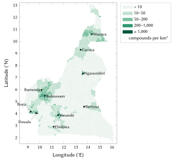
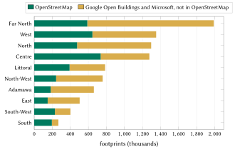
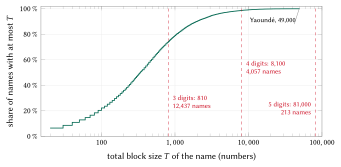
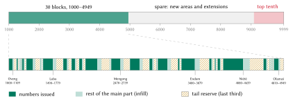
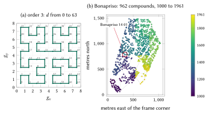
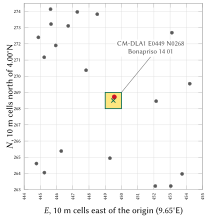

# Introduction

## The problem

An address tells a stranger where to go. In Cameroon most homes have none that a stranger can use. The Universal Postal Union's addressing sheet for the country has no postcode line: its model address is a name, "BP 6000" and "YAOUNDÉ" [@upu2002cameroon]. Mail goes to post-office boxes (*boîtes postales*, BP), which identify a counter, not a dwelling; the national daily put it plainly in 2024: the post-office box "is not considered a real address" [@nsangou2024adresse]. In November 2024 the press reported that the government had created postcodes covering the whole territory, assigned per commune and issued through the Campost–FindMe application [@njoya2024campost; @eyango2024campost]. Two years later no list, format or example of these codes is public.

Yaoundé and Douala began coding their streets and numbering their doors in 1992 under the World Bank's second Urban Development Project [@farvacque2005; @batamag2017douala]. The work produced the coded street names still seen in the capital ("Rue 1.014") and metric door numbers in parts of both cities, but in 2019 fewer than 15 % of Douala's roads carried a name [@tsayid2019rues], and Njoh describes the national effort as confined to the two largest cities and to naming rather than physical addressing [@njoh2010toponymic]. Elsewhere, and for most homes even in those cities, directions are given by quarter and landmark: "Bonapriso, behind the bakery".

The consequences are ordinary and costly. A delivery or a moto-taxi ride ends with a telephone call; an ambulance reaches the quarter and then searches for the gate; a bank, an employer or a school asks for an address that cannot be written down; a family abroad sends money and goods to a description. One compound behind one gate holds several households and rented rooms, and in the villages of the forest and of the north, houses stand along tracks with no name.

Conventional street addressing names streets, numbers doorways and maintains an address directory [@farvacque2005]. It is effective where it is completed and maintained, but it is slow and depends on signs that must be installed and kept. Its average cost in a World Bank review of 21 African cities was US\$5.7 per addressed doorway at 2005 prices [@farvacque2005].

## Contribution

This paper presents a national addressing model for Cameroon and the registry built from it. Its contributions are:

1. **A code people can say and remember.** A code is the name of a place people already use and a number of at most five digits, read in pairs like a telephone number: *Bonapriso 14 01*.
2. **National uniqueness without context.** Each name owns one national range of numbers, cut into frozen blocks, one per area that carries the name, so that a code identifies one compound in the whole country without a town, division or device position.
3. **Locality and growth.** Numbers follow a Hilbert curve over each area, leave gaps for new homes and keep a reserve, so that neighbours have neighbouring numbers and new compounds can be numbered between them.
4. **Integrity for systems.** A machine form carries a Damm check digit over the name, the arrondissement, the area and the number, which detects every single-digit error and every transposition of adjacent digits.
5. **Respect for official addresses.** Where a council's coded street passes the compound, it is shown first; council door numbers and Campost's codes fill reserved fields the day they are shared or published.
6. **Complete, open coverage.** All 7,243,272 compounds identified in the country received a code on 21 October 2026. The specification, the reference engine, the registry and a ready-to-deploy server are published under open licences [@nways2026repo].
7. **Evaluation and impact.** We measure the properties of the issued codes and estimate, under stated assumptions, their effect for citizens, logistics, emergency services and government.

## Structure of the paper

Section 2 reviews Cameroon's existing postal, addressing and land systems and international practice. Section 3 describes the data. Section 4 sets out the model rule by rule, with a worked example on a real code for each formula. Section 5 describes the implementation and Section 6 the evaluation. Section 7 reports the designs we considered and rejected, with measurements. Sections 8 to 11 estimate the benefits for citizens, logistics and commerce, emergency services, and government. Section 12 discusses privacy, safety and governance, Section 13 the limitations, and Section 14 concludes.

# Background and related work

## Territory, population and languages

Cameroon has ten regions, 58 divisions (*départements*) and 360 subdivisions (*arrondissements*), each the territory of one council (*commune*); fourteen city councils (*communautés urbaines*) group the numbered councils of the larger towns, such as Douala I to VI and Yaoundé I to VII. Law no. 2019/024 of 24 December 2019, the General Code of Regional and Local Authorities, gives the English-speaking North-West and South-West regions a special status [@loi2019cgctd]. French and English are the official languages, and more than 250 languages are spoken; Cameroonian Pidgin English, Fulfulde, Ewondo and Duala serve as common languages in their regions [@echu2004language]. The last published census, the third, counted 17,463,836 inhabitants in 2005; the fourth completed its fieldwork on 15 September 2026 and has not yet published results, while the census bureau's projection before enumeration exceeded 28.8 million [@kimeng2026census].

## Post and the post-office box

The UPU sheet for Cameroon gives a model address with a box number and a town and no postcode [@upu2002cameroon]. Campost and the private company FindMe signed a partnership on 1 November 2024; FindMe had operated in Cameroon since July 2024, and its address takes the form "occupancy number, street name, postal code, city" [@njoya2024campost]. The press reported that Cameroon "had no postal codes for its communes" and that codes are now assigned per commune [@eyango2024campost]. A certified address, the *plan de localisation postale* (PLP), costs 2,000 FCFA [@nsangou2024adresse]. On 21 October 2026 neither Campost's website nor any public document showed a list, a format or an example of the commune codes [@campost2026].

## Coded streets and door numbers in Yaoundé and Douala

The World Bank's review documents the programme of the two cities in detail [@farvacque2005]. Each urban area was divided into six major zones; a street is identified by two figures, the zone and a sequential number (street 4.15 is the fifteenth street of zone 4); doors are numbered metrically, with even and odd numbers on opposite sides; and the survey recorded the occupant's name, plot use and cadastral references. A presidential circular on street names dates from 1971. This explains the form of the addresses in use today: the United Nations' offices in Yaoundé give their address as a door number on a coded street, a building name and a quarter ("Rue 1794, Ekoudou, Bastos") [@un2026contact]. OpenStreetMap names 8,625 streets of the two cities, 7,531 of them with their code. We found no public look-up and no open data of either city's door numbers.

## Land, mapping and the absence of an address register

Land titles and cadastral plans are kept by the Ministry of State Property, Surveys and Land Tenure (MINDCAF); they identify land, not the gate a courier stops at, and most homes have none. The national geodetic reference used in the cadastre has moved from the Douala 1948 datum to Manoca 1962 / UTM zone 32N [@epsg2215]. A World Bank project approved in May 2025 addresses land administration and urban infrastructure, not street addressing [@worldbank2025cameroon]. The Institut National de Cartographie (INC) is the national map producer; by the country's report to the United Nations Group of Experts on Geographical Names, toponymic work in 2023–2024 remained hampered by the economic situation and by insecurity in the North-West and South-West [@simeu2025ungegn]. We found no national address register, no national addressing law and no national geoportal of addresses.

## International practice

The UPU's S42 standard defines how postal addresses are structured and rendered in each country [@upuS42], and ISO 19160-1 provides a conceptual model of addresses [@iso19160]. Both describe addresses; neither creates them where streets have no names. The UPU's report *Addressing the World* argues that an address for every dwelling is a precondition for postal, financial and civil services [@upu2012addressing]. The World Bank's programme of street addressing in African cities, which included Yaoundé and Douala, is the reference for conventional practice [@farvacque2005]. Several countries of the region have adopted national digital address systems based on grid codes; Ghana's, introduced in 2017, derives a code from the location's grid cell [@bokpe2017ghana].

## Other code systems

Grid codes such as Open Location Code (Plus Codes) give any point on Earth a short code from its latitude and longitude [@olc]. They work offline, but their codes mix letters and digits, carry a plus sign and say nothing that a resident recognises: "6FR5JCH8+5QV" is hard to dictate in French, English or Pidgin, and no one remembers it. Proprietary word-based systems are not open. Neither type is unique to a home: two gates of one compound have two codes, and one code can cover two homes. The model presented here uses a grid only for points that are not homes (Section 4.10), and keeps names people say for homes.

# Data and sources

## Boundaries and named places

The 360 arrondissements are taken from OpenStreetMap (administrative level 8), and the named places from OpenStreetMap (city, town, suburb, quarter, neighbourhood, village, hamlet and locality) and from GeoNames populated places [@geofabrik2026cameroon; @haklay2008osm; @geonames]. Each arrondissement receives a key of four characters (YDE6 for Yaoundé VI, DLA1 for Douala I, BDA2 for Bamenda II) and a frozen index from 0 to 359. Figure 1 shows the arrondissements shaded by the density of compounds.

{width=92%}

## Building footprints

Building footprints come from OpenStreetMap and, where OpenStreetMap has none, from Google Open Buildings [@sirko2021openbuildings] and Microsoft's global footprints [@microsoft2023footprints], both through the Overture Maps Foundation [@overture2026buildings]. A footprint from Google or Microsoft is kept only where no OpenStreetMap building overlaps it. Footprints under 1 m² are dropped, as are 182,507 footprints outside the border. The result is 9,293,569 footprints: 3,836,259 from OpenStreetMap and 5,457,310 from the other two datasets. The median footprint is 51 m². Figure 2 shows the sources by region: OpenStreetMap is the majority source in the Centre, the South and the South-West, and the machine-detected footprints dominate in the Far North, where 70 % of footprints come from them.

{width=88%}

## Official streets, walls and gates

From OpenStreetMap we also take the named streets of Yaoundé and Douala with their codes, the walls, fences and hedges that enclose compounds (854 mapped enclosures with buildings inside), and the mapped gates and entrances. Every compound records the nearest official street within 30 m.

## Verification of existing systems

The existing systems were verified between 17 and 21 October 2026 by opening each source and reading it; the full record, with each source marked as read or seen only in search results, is in `docs/existing-systems.md` of the repository [@nways2026repo].

# The model

## The forms of one code

One compound has several forms of one code, each for a different reader.

| Form | Example | Used by |
|:--|:--|:--|
| Remembered (written) | *Bonapriso 14 01*, said "Bonapriso, quatorze, zéro un" | people: said, typed, written on a parcel |
| Five digits | *Mokolo 18 834*, said "dix-huit, huit cent trente-quatre" | larger and more repeated names |
| Three digits | *Intendance 137*, said "cent trente-sept" | small areas |
| Machine | CM-DLA1-015-1401-6 | applications, QR codes, partners; the final digit is the check |
| Structure, entrance | CM-DLA1-015-1401-6.2/1 | a building of the compound; one of its gates |
| Spot | CM-DLA1 E0449 N0268 | any point: a stall, a field, a market place |
| Official | Rue 1.014, Yaoundé | the council's address, shown first where it exists |

: The forms of one code. {#tbl:forms}

Let $P$ be the area's plate name, $N$ the number of $n \in \{3,4,5\}$ digits, $Z$ the arrondissement's key, $I$ the area's three-digit index within it, and $c$ the check digit (Section 4.9). The two principal forms are

$$
\text{remembered} = P \;\sqcup\; g(N), \qquad
\text{machine} = \texttt{CM-}Z\texttt{-}I\texttt{-}N\texttt{-}c,
\tag{1}
$$

where $\sqcup$ is a space and $g$ groups the digits as they are said: $g(137) = \text{137}$, $g(1401) = \text{14 01}$, $g(18834) = \text{18 834}$. A plate name never contains a digit, so the number always begins at the first digit of the text.

## Units and code areas

A *code area* is a named place of one arrondissement: an OpenStreetMap place, or a GeoNames populated place unless it lies within 1 km of an OpenStreetMap place of the same name. A second place of one name within 300 m of the first is dropped. This yields 24,213 areas, of which 23,208 contain homes. Every footprint $f$ takes the nearest place point of its own arrondissement $U(f)$:

$$
a(f) = \operatorname*{arg\,min}_{a \in U(f)} \Big[ (\lambda_f - \lambda_a)^2 \cos^2 \varphi_f + (\varphi_f - \varphi_a)^2 \Big],
\tag{2}
$$

with $\lambda$ the longitude and $\varphi$ the latitude, and ties broken by the lower area key. Each area is frozen at first issue: its key, its block of numbers and its *frame*, the bounding box $(x_0, y_0, x_1, y_1)$ of its footprints' centres, over which its numbers are laid out. Yaoundé has 307 areas and 346,523 compounds, Douala 267 areas and 410,644 compounds; the largest area, Alphonse (Carrefour Alphonse, Douala III), holds 19,107 compounds. Figure 3 shows the distribution of area sizes.

{width=88%}

## Plate names

A name on a gate, a parcel or a telephone call must be short. A plate name $s$ is admissible when

$$
\operatorname{ok}(s) \iff \lvert \operatorname{NFC}(s) \rvert \le 12 \;\wedge\; \lvert \operatorname{words}(s) \setminus L \rvert \le 2 \;\wedge\; s \text{ has no digit},
\tag{3}
$$

where $\lvert\cdot\rvert$ counts Unicode characters after canonical composition and $L$ is the set of articles and prepositions that are not counted: $L_{\text{fr}} = \{$de, du, des, d, la, le, les, l, et, sur, en, au, aux, à$\}$ in the 295 French-speaking arrondissements and $L_{\text{en}} = \{$of, the, and, on, at$\}$ in the 65 arrondissements of the North-West and South-West, where plate names follow English usage.

An official name that fails Eq. (3) is shortened by fixed steps, and the first step that succeeds is kept: cleaning (brackets; the generic words Quartier, Carrefour, Lotissement, Cité, Village, Quarter, Layout, Junction: "Carrefour Intendance" becomes *Intendance*); "Saint" becomes "St"; then the most distinctive run of whole words, taken only when it is clearly ahead of the alternatives. A word is never cut.

Cameroonian place names often join a landmark word to the place's own name: "Carrefour Laboratoire Meka", "Mission Catholique Mokolo", "Place du Président Ahmadou Ahidjo". The rule therefore carries a list of 186 ordinary French and English words (*laboratoire, mission, catholique, président, cimetière, poteau, school, junction*, …) that count as weak, so that a short form keeps the proper name (*Meka*, *Mokolo*, *Ahidjo*) and never the landmark. Words of the national languages that form part of names (Ouro, Mayo, Hosséré, Djaouro, Nkol, Mvog, Elig) are names, and so are the names of peoples (Haoussa, Foulbé). Where the only short form would contain a digit, consist of ordinary words only ("Vallée de la Mort" would give "Mort"), cut a phrase ("Yenga Sans" from "Yenga Sans Famille") or name another town, the area carries its arrondissement's name until the council chooses.

| Areas | Count |
|:--|--:|
| Plate name equal to the official name | 22,024 |
| Cleaned of generic words | 214 |
| Shortened to the distinctive words | 738 |
| Abbreviated | 1 |
| Left to the council, with candidates | 1,236 |
| *of which still over the limit of Eq. (3)* | *210* |
| Official names over 12 characters or two words | 2,122 |

: How the plate names of the 24,213 areas were obtained. {#tbl:plates}

The 1,236 areas flagged for their councils carry a provisional plate name; 487,712 codes were issued under such a name, and a council may change it once. The official name always remains an alias (1,773 aliases are kept; 37 are dropped because two plate names claim them), so typing the full official name finds the same compound.

## The name key

Two spellings of one name must decode to the same range. The key of a name is the composition

$$
\kappa(s) = \sigma \circ \phi \circ \jmath \circ \alpha \circ \eta \circ \tau \circ \upsilon \circ \mu\,(s),
\tag{4}
$$

applied right to left: $\mu$ removes accents and $\upsilon$ converts to upper case; $\tau$ expands St and Ste to Saint and Sainte; $\eta$ drops a leading head word (Q, Quartier, Quarter, Hameau, Village de) and $\alpha$ a leading article (le, la, les, the, l'); $\jmath$ removes every character other than A–Z and 0–9; $\phi$ folds spelling variants common in Cameroonian orthography (tch and ch to c; dj to j; gh to g; ph to f; ck to k; ou and w to u; gu before i or e to g); and $\sigma$ writes a doubled letter once. Digits are never squeezed, so "Mile 22" stays apart from "Mile 2". By construction $\kappa$ can only merge spellings, never split one name into two: Djoungolo and Joungolo, Tchinga and Chinga, Douala and Duala, Ekellé and Ekele each share a key. The 24,213 areas carry 17,240 plate names; 3,886 names are shared by 10,859 areas, among them 30 areas named Adjap (one spelt Ajap), 27 Mélen, 27 Yaoundé (a provisional name), 26 Akak and 24 Akom.

## One national range per name

Every name owns one national range of numbers of a fixed length: 100–999, 1000–9999 or 10000–99999. Let a name be carried by $k$ areas with $c_1, \dots, c_k$ compounds, in the frozen order of their keys (arrondissement, then area index). Each area receives a block of size

$$
B(c) = \max\!\Big(20,\; 10 \Big\lceil \frac{2c}{10} \Big\rceil\Big),
\tag{5}
$$

twice its compounds rounded up to a whole ten, and at least 20. The total size of the name's blocks and the number of digits of its range are

$$
T = \sum_{i=1}^{k} B(c_i), \qquad
d = \min \big\{ \delta \in \{3,4,5\} : T \le \lfloor 0.9 \cdot 9 \cdot 10^{\delta-1} \rfloor \big\},
\tag{6}
$$

so that the top tenth of every range (beyond 810, 8,100 or 81,000 numbers) is always spare. The blocks are laid end to end from the bottom of the range:

$$
F_1 = 10^{d-1}, \qquad F_{j+1} = F_j + B(c_j), \qquad \text{block}_j = [F_j,\, F_j + B(c_j)).
\tag{7}
$$

**Worked example: Bonapriso.** The name has one area, in Douala I, with 962 compounds. By Eq. (5), $B = 10 \lceil 1924/10 \rceil = 1930$. Since $810 < T = 1930 \le 8100$, Eq. (6) gives four digits, and Eq. (7) gives the block 1000–2929; the numbers 2930–9999 are spare.

**Worked example: Alphonse**, the largest area, with 19,107 compounds: $B = 10\lceil 38214/10 \rceil = 38220$, and $8100 < 38220 \le 81000$ gives five digits and the block 10000–48219.

**Worked example: Adjap**, the most repeated name, carried by 30 areas in 17 arrondissements of the South and Centre regions. Their blocks sum to $T = 3950 \le 8100$, so the name has four digits; the blocks run from 1000 to 4949, and the numbers 4950–9999 are spare (Figure 5). *Adjap 10 50* lies in Oveng and *Adjap 48 50* in Olamzé: the number alone says which.

Figure 4 shows the distribution of $T$ over all names. 12,437 names fit three digits, 4,057 four and 213 five. No name needs a qualifier and no area had to be split: the fullest range, that of the 27 areas provisionally named Yaoundé, uses 49,000 of its 81,000 numbers.

{width=88%}

{width=100%}

| Digits | Areas | Compounds | Share of compounds |
|:--|--:|--:|--:|
| 3 | 14,849 | 1,640,038 | 22.6 % |
| 4 | 7,574 | 4,170,120 | 57.6 % |
| 5 | 785 | 1,433,114 | 19.8 % |

: Digits of the issued numbers, over the 23,208 areas with compounds. {#tbl:digits}

**Growth.** A new area of an existing name, or an area whose block is full, takes the next block above every block already given to its name, from the spare. Blocks never move, shrink or get renumbered.

## Numbering within an area: the Hilbert curve

Numbers should be local: neighbouring compounds should have neighbouring numbers, so that a courier who finds 14 01 knows that 14 02 is close. We order the compounds of an area along a Hilbert curve [@hilbert1891], whose clustering properties are the best known among space-filling curves [@moon2001hilbert]. Each compound's reference point $(\lambda, \varphi)$ (the centre of its largest building until a gate is confirmed) is mapped to a cell of a $2^{16} \times 2^{16}$ grid over the area's frame,

$$
g_x = \Big\lfloor \frac{\lambda - x_0}{x_1 - x_0} \cdot (2^{16} - 1) \Big\rfloor, \qquad
g_y = \Big\lfloor \frac{\varphi - y_0}{y_1 - y_0} \cdot (2^{16} - 1) \Big\rfloor,
\tag{8}
$$

and the cell's distance $h(g_x, g_y)$ along the curve is computed by the standard recursion over the bit levels $s = 2^{15}, 2^{14}, \dots, 1$: with $r_x = [g_x \wedge s \ne 0]$ and $r_y = [g_y \wedge s \ne 0]$, add $s^2 \cdot \big((3 r_x) \oplus r_y\big)$ to $h$; then, if $r_y = 0$, reflect the cell ($g \mapsto 2^{16} - 1 - g$ on both axes) when $r_x = 1$ and swap $g_x$ and $g_y$. Panel (a) of Figure 6 shows the order of the cells for a curve of order 3.

The $m$ compounds of an area with block $[F, F + B)$, sorted by $(h, \text{stable identifier})$ and indexed $i = 0, \dots, m-1$, receive

$$
M = \Big\lfloor \frac{2B}{3} \Big\rfloor, \qquad
\Delta = \max\!\Big(1,\; \Big\lfloor \frac{M}{\lfloor 1.5\, m \rfloor} \Big\rfloor\Big), \qquad
N_i = F + i\,\Delta,
\tag{9}
$$

so that the first two thirds of the block, the *main part* $[F, F+M)$, carry the first issue with gaps of $\Delta - 1$ numbers for infill, and the last third, the *tail reserve* $[F + M, F + B)$, is kept for later.

**Worked example: Bonapriso 14 01.** The compound's reference point is $\varphi = 4.0243022$, $\lambda = 9.6904852$; Bonapriso's frame is $(9.687462,\, 4.017162,\, 9.697280,\, 4.031143)$. Eq. (8) gives

$$
g_x = \Big\lfloor \frac{0.0030232}{0.009818} \cdot 65535 \Big\rfloor = 20179, \qquad
g_y = \Big\lfloor \frac{0.0071402}{0.013981} \cdot 65535 \Big\rfloor = 33469,
$$

and $h = 2\,062\,693\,980$, the 402nd of the area's 962 positions along the curve ($i = 401$). With $B = 1930$, Eq. (9) gives $M = 1286$ and $\Delta = \max(1, \lfloor 1286/1443 \rfloor) = 1$, hence $N = 1000 + 401 = 1401$; the tail reserve is 2286–2929. Panel (b) of Figure 6 shows all 962 compounds of Bonapriso coloured by number.

{width=100%}

## A new home

A compound built after first issue is placed between its two neighbours on the curve. Let $a$ be the number of the last issued compound at or before its position $h$ and $b$ the number of the first after it ($a = F - 1$ and $b = F + M$ at the ends). The new compound receives

$$
N^{*} = \operatorname*{arg\,min}_{x \in \mathcal{F},\; a < x < b,\; x < F + M} \Big( \big\lvert x - \tfrac{a+b}{2} \big\rvert,\; x \Big),
\tag{10}
$$

the free number $x$ (in the set $\mathcal{F}$ of numbers never issued) nearest the midpoint, the lower on a tie; if there is none, the lowest free number of the tail reserve; then of the area's later blocks; and if the area is full, a new block of its name from the spare (Section 4.5). In Bonapriso $\Delta = 1$, so the main part has no gaps between neighbours, and a house built between two of them receives *Bonapriso 22 86*, the first number of the tail reserve. A number is never reused, even after its code is retired.

## Decoding without context

The decoder reads a text as a name followed by three to five digits, with or without spaces, and returns the set of areas

$$
D(P, N) = \big\{ a : \kappa(P) \in \{\kappa(a)\} \cup \operatorname{aliases}(a),\; \lvert N \rvert = d(\kappa(P)),\; N \in \operatorname{blocks}(a) \big\}.
\tag{11}
$$

Because the blocks of one name are disjoint, $\lvert D \rvert \le 1$ for every input. A number in no block, in a name's spare or with the wrong number of digits is reported as not issued; it is never corrected or guessed. A name that also exists in another country is resolved by the number, then by the user's position; when neither decides, no country is assumed.

## The check digit

The machine form ends with a check digit computed by Damm's algorithm [@damm2004; @damm2007], a decimal method that, unlike the Luhn and Verhoeff schemes [@verhoeff1969], uses a single table and detects every single-digit error and every transposition of two adjacent digits. Let $u = u_1 u_2 \cdots u_\ell$ be the concatenation of the name's national index on five digits, the arrondissement's index on three, the area index on three and the number. Then

$$
c_0 = 0, \qquad c_j = Q[c_{j-1}][u_j] \quad (j = 1, \dots, \ell), \qquad c = c_\ell,
\tag{12}
$$

where $Q$ is the table of a totally anti-symmetric quasigroup of order 10:

| $Q$ | 0 | 1 | 2 | 3 | 4 | 5 | 6 | 7 | 8 | 9 |
|:-:|:-:|:-:|:-:|:-:|:-:|:-:|:-:|:-:|:-:|:-:|
| **0** | 0 | 3 | 1 | 7 | 5 | 9 | 8 | 6 | 4 | 2 |
| **1** | 7 | 0 | 9 | 2 | 1 | 5 | 4 | 8 | 6 | 3 |
| **2** | 4 | 2 | 0 | 6 | 8 | 7 | 1 | 3 | 5 | 9 |
| **3** | 1 | 7 | 5 | 0 | 9 | 8 | 3 | 4 | 2 | 6 |
| **4** | 6 | 1 | 2 | 3 | 0 | 4 | 5 | 9 | 7 | 8 |
| **5** | 3 | 6 | 7 | 4 | 2 | 0 | 9 | 5 | 8 | 1 |
| **6** | 5 | 8 | 6 | 9 | 7 | 2 | 0 | 1 | 3 | 4 |
| **7** | 8 | 9 | 4 | 5 | 3 | 6 | 2 | 0 | 1 | 7 |
| **8** | 9 | 4 | 3 | 8 | 6 | 1 | 7 | 2 | 0 | 5 |
| **9** | 2 | 5 | 8 | 1 | 4 | 3 | 6 | 7 | 9 | 0 |

: Damm's quasigroup table $Q$: row $c_{j-1}$, column $u_j$. {#tbl:damm}

**Worked example.** Bonapriso's national index is 02616, Douala I's index 020, the area's index 015 and the number 1401, so $u = 026160200151401$:

| $u_j$ | 0 | 2 | 6 | 1 | 6 | 0 | 2 | 0 | 0 | 1 | 5 | 1 | 4 | 0 | 1 |
|:--|:-:|:-:|:-:|:-:|:-:|:-:|:-:|:-:|:-:|:-:|:-:|:-:|:-:|:-:|:-:|
| $c_j$ | 0 | 1 | 4 | 1 | 4 | 6 | 6 | 5 | 3 | 7 | 6 | 8 | 6 | 5 | 6 |

: The Damm chain of Bonapriso 14 01. {#tbl:chain}

The check digit is 6 and the machine form CM-DLA1-015-1401-6. Because the name's index, the arrondissement and the area enter the check, a number moved to another area of the same name fails both the check and the block test of Eq. (11). The check digit lives only in the machine form: it is never shown to people, never typed by them, and verified whenever a system sends a code.

## Spot codes

Any point, home or not, has a *spot code*: its arrondissement's key and its distance east and north of the arrondissement's frozen origin $(\lambda_0, \varphi_0)$, the south-west corner of its bounding box floored to 0.01°, in units of 10 m:

$$
k_x = 111\,320 \cos \varphi_c, \qquad k_y = 110\,574, \qquad
E = \Big\lfloor \frac{(\lambda - \lambda_0)\, k_x}{10} \Big\rfloor, \qquad
N = \Big\lfloor \frac{(\varphi - \varphi_0)\, k_y}{10} \Big\rfloor,
\tag{13}
$$

where $k_x$ and $k_y$ are metres per degree of longitude and latitude and $\varphi_c$ is the frame's reference latitude (the centre of the box, rounded to 0.01°). Each axis has four digits, or five where the arrondissement spans more than 99.99 km. Decoding returns the centre of the cell, so the error is bounded by half the cell's diagonal:

$$
\varepsilon \le \tfrac{1}{2} \sqrt{10^2 + 10^2} \approx 7.07 \text{ m}.
\tag{14}
$$

**Worked example.** For Bonapriso 14 01, in Douala I's frame ($\lambda_0 = 9.65$, $\varphi_0 = 4.00$, $\varphi_c = 4.05$): $k_x = 111\,042$; $E = \lfloor 0.0404852 \times 111\,042 / 10 \rfloor = \lfloor 449.56 \rfloor = 449$ and $N = \lfloor 0.0243022 \times 110\,574 / 10 \rfloor = \lfloor 268.72 \rfloor = 268$, hence the spot code CM-DLA1 E0449 N0268. Its decoded centre lies 2.3 m from the point (Figure 7). A spot code is shared by link; it is never needed to find a home.

{width=70%}

**Points in no outline.** The arrondissement outlines are generalised, so 240 issued compounds lie in no outline: 67 in slivers between arrondissements, 172 just over an outline at the shoreline or the national border, all within 62 m of one, and one industrial structure at sea, 10.9 km off Kribi. Such a point takes its arrondissement from those whose outline lies within 12 km: among them, the one with the nearest outline whose frame holds the point, distances being measured to the nearest edge with longitude differences scaled by $\cos\varphi$ and ties going to the lower key; if no such frame holds it, the nearest cell of a frame at most 5,000 m away. Frames are never moved or widened, because either would change spot codes already published, and the decoder is unchanged, since a spot code names its arrondissement. Every issued compound therefore has a spot code, and the registry keeps its exact entrance point. For example, a compound of Yoyo Bar (Yaoundé II) at $\varphi = 3.8751747$, $\lambda = 11.4844409$ lies in a sliver 5.6 m from Yaoundé VII's outline and 9.7 m from Yaoundé II's, falls in Yaoundé VII's frame and receives CM-YDE7 E0826 N0499. The structure at sea lies 4.49 km beyond the frame of Kribi I and receives its nearest edge cell, CM-KRI1 E0000 N3321.

## Compounds: grouping structures

The registry numbers compounds, not buildings. Before any number is given, the footprints of each area are grouped by four rules, in a fixed order by stable identifier. Distances are measured between outlines,

$$
\operatorname{dist}(f, f') = \min_{p \in \partial f,\; q \in \partial f'} \lVert p - q \rVert, \quad \text{and } 0 \text{ when } f \text{ and } f' \text{ touch or overlap}.
\tag{15}
$$

| Rule | Condition | Effect |
|:--|:--|:--|
| Enclosure | the footprint's centre lies inside a mapped closed wall, fence or hedge | the enclosure is one compound |
| Annex | a footprint under 25 m² (kitchen, wash house, store) | joins the nearest footprint of at least 25 m² within 8 m |
| Hut cluster | outside Yaoundé and Douala: huts under 40 m² that belong to no house, at most 3 m apart | one compound of at most 25 huts |
| Single | any other footprint | its own compound |

: Grouping rules. {#tbl:group}

Only annexes join a house, and a hut cluster never joins two houses, so groups cannot chain across a quarter. The rules produced 7,243,272 compounds from 9,293,569 footprints, 1.28 footprints per compound: 5,795,550 single buildings, 1,155,565 houses with their annexes, 290,494 hut clusters and 1,663 compounds within mapped walls. By size, 5,796,261 compounds have one structure, 1,062,820 two, 256,178 three and 128,013 four or more.

| Region | Compounds | Footprints | Median footprint |
|:--|--:|--:|--:|
| Far North | 1,265,948 | 1,990,468 | 19.7 m² |
| West | 1,209,040 | 1,351,691 | 86.2 m² |
| Centre | 1,101,839 | 1,276,238 | 75.6 m² |
| North | 866,358 | 1,296,326 | 17.1 m² |
| North-West | 673,661 | 758,785 | 67.6 m² |
| Littoral | 647,775 | 785,844 | 68.8 m² |
| Adamawa | 494,453 | 661,153 | 27.3 m² |
| East | 404,924 | 503,703 | 41.4 m² |
| South-West | 341,541 | 401,418 | 76.1 m² |
| South | 237,733 | 267,943 | 80.6 m² |

: Compounds and footprints by region. The small median footprints of the Far North, North and Adamawa reflect round huts. {#tbl:regions}

**Validation.** We re-ran the rules on the 854 mapped enclosures with the enclosures hidden from them: 10.5 % of the enclosed compounds come out whole and 9.3 % exactly, and a further 40.4 % miss only one building. Behind a wall, the main house, the rooms and the kitchen are separate buildings, and with no wall mapped the rules keep them apart deliberately: merging two codes later costs nothing, whereas splitting a wrong merge gives a household a new code. Residents' answers in the N-Ways application ("these buildings are one home", "here is the gate") complete the grouping.

## The building profile

Every structure carries a use class with its confidence and source, its size, its floors where known and a status. Classes are inferred in a fixed order: the OpenStreetMap building type (confidence 0.85), a shop, amenity or office tag on the footprint (0.75), an N-Ways place inside it (0.65), the footprint's size (0.3–0.4), and otherwise residential by default (0.45). Of 9,293,569 structures, 9,156,024 are classed residential, nearly all by the default; 82,878 are annexes, 14,633 under construction, 14,446 commercial, 8,090 educational, 3,618 industrial, 3,551 governmental, 2,922 religious and 2,635 health buildings. OpenStreetMap gives floors for 1,835 buildings; the heights in the machine-detected datasets are not used. A home never carries a name.

# Implementation

## The reference engine

The reference engine (`engine/reference/cm_engine.py` and `plate_names.py`) implements every rule of Section 4 in Python with the standard library only: parsing of every form, the name key, plate names, blocks and ranges, the Hilbert numbering, insertion, decoding, the Damm check and spot codes. The normative specification is `engine/SPEC.md`. The engine ships with its data: `engine/data/register.json` (every arrondissement with its spot frame, every area with its plate and official names, name index, blocks and frame, and the aliases) and `engine/data/units.json` (the arrondissement outlines). It decodes offline, with no server. Conformance vectors (`engine/reference/vectors.json`) give 722 name keys, 500 code forms, 2,394 point look-ups, 698 spot codes, 470 points in no arrondissement outline (the 240 issued compounds among them, points beyond a frame and refusals), Hilbert indices and grouping cases; any other implementation must reproduce them.

## The registry

The registry (`registry/`) publishes every issued code: one gzip-compressed CSV file per arrondissement (360 files, 7,243,272 rows), the frozen area table `areas.csv.gz` (24,213 areas with their blocks, names, frames and counts) and `MANIFEST.json`, which gives the count of each file and the SHA-256 of each file uncompressed. Each row holds the three forms, the area, the number and check, the status (*provisional* until residents confirm it), the issue date, the entrance point and its kind, the spot code, the official address where one applies, and the building profile. Building outlines are not republished: they remain in their source datasets, from which they can be joined.

## The server and its API

The repository includes a deployable server (`server/`), written in Python with the standard library only and reusing the reference engine. `import` streams the registry into SQLite, verifies each file against the manifest and refuses a mismatch, and builds indexes on every form and an R\*-tree spatial index [@guttman1984; @beckmann1990]. `serve` exposes a JSON API under `/v1`, described by an OpenAPI 3.1 contract [@openapi31]: health and information, the full card of a code, search by any form as people type it, the code at a point, codes near a point, verification, spot codes, arrondissements and areas, and paged listings. `export` writes the registry back in the published format; after an import of the published registry the export is byte-identical, file by file, when uncompressed. A Docker image imports the bundled registry on first start, so that `docker compose up` is a complete deployment.

The server can also issue codes by the issuer's own rules: the duplicate checks (an entrance within 3 m, or a point inside an issued outline), the outline limits (6 m² to 2 ha), the placement rule (the area of the nearest issued code within 250 m, else the area containing the point), numbering by Eq. (10) with extension blocks, the 80 m rule for further doors and the per-key daily limit. Issuing must come from one issuer per country, because two issuers working from the same registry would give the same free number to two homes; a deployment therefore issues only when the State or N-WAYS LIMITED has designated it, and otherwise runs read-only.

## Conformance

Parity with the issuer is tested case by case: 253 issue requests posted in order (points near real compounds, points already coded, points far from any code, points outside the country, and 215 doors of one compound that fill its area and open an extension block), 12 single insertions and 83 point look-ups, each computed by the issuer's own implementation from the same register; the server reproduces all of them. On the full registry, 50 random codes in 45 arrondissements agreed field by field with the issuer's service, and the full import took 166 s and produced a 3.4 GB database.

# Evaluation

We measured the properties of the issued codes on the complete registry (exported on 21 October 2026, 14:51 UTC). The script is `tools/paper-figures.py` and its results are in `model/stats/evaluation.json`.

| Property | Measure | Result |
|:--|:--|:--|
| Coverage | codes against compounds | 7,243,272 of 7,243,272 |
| Uniqueness | distinct pairs (name key, number) | 7,243,272; no duplicate |
| Length | digits of the number | 3: 22.6 %; 4: 57.6 %; 5: 19.8 %; never more |
| Block integrity | numbers outside their area's block | 0 |
| Check digits | recomputed by Eq. (12) | 0 mismatches |
| Error detection | single substitutions in 1,000 machine codes | 143,784 of 143,784 detected |
| | adjacent transpositions of distinct digits | 13,226 of 13,226 detected |
| Decoding | 20,000 random codes, by Eq. (11) | 100 % as written, lower case, without accents and without spaces |
| Spot codes | largest error, 20,000 points | 7.0 m (bound of Eq. (14): 7.07 m) |
| | compounds with a spot code | 7,243,272 of 7,243,272; 240 in no outline, 239 of them within 6.9 m of their cell centre |
| Plate names | inhabited areas satisfying Eq. (3) | 23,009 of 23,208 (99.1 %) |
| Locality | median distance, consecutive numbers | 29.5 m, against 517.5 m for random pairs of the same area |
| Official address first | compounds within 30 m of a coded street | 207,707 (2.9 %) |

: Measured properties of the registry. {#tbl:eval}

**Uniqueness and length.** No two compounds share a written form, and no number has more than five digits. Five digits is the length people say as a pair and a hundred; it stays within the span of short-term memory for digit groups [@miller1956; @cowan2001].

**Integrity.** Every check digit agrees with Eq. (12), and every number lies within its area's block. Exhaustive tests on 1,000 random machine codes confirm the theoretical guarantee of Damm's construction: every one of the 143,784 possible single-digit substitutions and every one of the 13,226 transpositions of adjacent distinct digits is detected.

**Decoding.** For 20,000 random codes, the decoder of Eq. (11) returned exactly the issued code from the written form as printed, in lower case, with accents removed and with the number written without its space. Because the blocks of a name are disjoint, no input can decode to two areas.

**Plate names.** 199 inhabited areas, holding 54,919 compounds, still have a plate name over the limit of Eq. (3), mostly single long words such as "Boundjoukoura"; all are among the 1,236 areas whose councils are asked to choose.

**Locality.** In a sample of 111,390 pairs drawn from every area with at least three compounds, the median distance between compounds with consecutive numbers is 29.5 m, against 517.5 m for random pairs within the same area: the Hilbert numbering keeps neighbours together.

# Designs considered and rejected

The model was chosen against measured alternatives. Each was evaluated on the same compounds.

| Option | Example | Measurement | Decision |
|:--|:--|:--|:--|
| National digits only | 48173052 | $2 \times 7.2$ M numbers need 8 digits | too long; says nothing about where |
| Arrondissement and digits | Douala III · 362 140 | Douala III, 181,571 compounds, needs 6 digits | too long, and the arrondissement must be said too |
| Town and digits | Yaoundé · 693 046 | Yaoundé, 346,523 compounds, needs 6 digits | too long |
| Town and letters | Douala 7HQ2X | $20^5 = 3.2$ M codes per town | letters must be learnt and spelled |
| Plus Code as the code | 6FR5JCH8+5QV | 10–11 characters with a plus sign | hard to dictate; not a home |
| A 3 m letter grid with a check letter | — | letters and a visible check | people remember names and numbers, not grid letters |
| Area name with numbering per area | Adjap 1050 in each of 30 areas | 1,434,705 codes (19.8 %) ambiguous | rejected |
| **Name and number from one national range per name** | ***Bonapriso 14 01*** | unique; at most 5 digits | **chosen** |

: Designs considered. {#tbl:designs}

**Per-area numbering.** The most natural design numbers each area on its own from $10^{d-1}$. We computed the numbers it would have given every compound by Eqs. (5) and (9) with each area treated as its own range: 1,434,705 codes, 19.8 % of all, would have shared their name and number with a compound of another area, and the code would then have needed a town or an arrondissement to be complete. The national range per name removes this ambiguity at the cost of some length: in shared ranges, some areas that would have fitted three digits need four.

**A visible check character.** A check digit shown to people is one more digit to remember and to get wrong, and people cannot verify it themselves. We keep the check in the machine form, where systems verify it, and rely on the block test of Eq. (11) to reject most mistyped remembered forms.

**Grouping of official spellings.** An early version of the plate rule grouped official names as spelling variants by the name key of Eq. (4). Because $\sigma$ writes a doubled letter once and $\phi$ folds "gui" into "gi", it showed "Njinga II" as "Njinga I" and "Mbengui" as "Mbeng I" in 892 areas. Variants are now grouped only by accents, case and punctuation, with word breaks kept. The rule was corrected before any code was confirmed by a resident.

**Landmark words as names.** Without the list of ordinary words, short forms took "Mort" from "Vallée de la Mort", "Laboratoire" from "Carrefour Laboratoire Meka" and "Catholique" from "Mission Catholique Mokolo"; the list changed the plate names of 160 areas.

**Spelling.** Where two spellings of one name met, the plate takes the one written with its accents ("Bessengué", not "Bessengue"), then the one more people live under; this settled 1,041 areas. Blangoua, on Lake Chad, had received its name in Arabic script from one source; its plate is in Latin script. A spelling never changes a name's key, so no number, range or check digit moved.

# Benefits for citizens

For a family in a compound of Nkolbisson, in a lane of New Bell or in a village of the Adamawa plateau, a code changes four ordinary things.

**Being found.** A visitor, a moto-taxi or a delivery rider is today guided by telephone, landmark by landmark. With a code, the resident says one short phrase, "Bonapriso, quatorze, zéro un", and the application leads to the gate.

**Proving where one lives.** Banks, mobile-money agents, schools and employers ask for an address. A post-office box says nothing about a home, and only 207,707 compounds (2.9 %) lie within 30 m of a coded street; with the registry, every compound has an address that can be checked.

**Receiving goods and services.** Families abroad, shops, and water and electricity services can deliver to a code rather than a description, and a household can request a connection or a repair at the right gate.

**No effort required.** Nothing is asked of the household: every compound already mapped has its code, and the application shows it in one tap. The code is free, requires no document and holds no personal data. It is not a land title, a PLP or an attestation of residence.

**Estimated value.** The cost of providing the same coverage by a conventional door-numbering survey is

$$
C = N_c \cdot \bar{c},
\tag{16}
$$

with $N_c$ the number of compounds and $\bar{c}$ the cost per addressed doorway. With $N_c = 7\,243\,272$ and $\bar{c} = \text{US}\$5.7$ at 2005 prices [@farvacque2005], $C \approx \text{US}\$41.3$ million. Allowing $\bar{c}$ to vary by half either way, for differences in prices and in field conditions between the cities of the review and rural Cameroon, gives US\$20.6–61.9 million. The model does not replace street signs where councils want them; it gives every home an address before they are installed.

**Who benefits most.** Those with least today: residents of unplanned quarters, villages far from the main roads, tenants who share a compound's gate, and anyone who reads French or English with difficulty, for whom a known place and a few digits are easier than a street name.

# Benefits for logistics and commerce

Delivery in Cameroon depends on the telephone and the moto-taxi. Up to 20 % of business-to-consumer deliveries fail on the first attempt in the operations literature [@lim2023delivery], and courier operators in African markets report first-attempt success rates as low as 60 %, with an average cost of about US\$2.70 per last-mile attempt [@odeloye2023lastmile].

**What the code provides.** A stable key for every customer (the machine form); routing to the gate, or to the main building until the gate is confirmed; fewer calls and failed trips; input checked by the Damm digit; and offline resolution, since the engine and the area table are open and any business can resolve codes in its own systems without payment.

**Estimated value.** For a reduction $\Delta f$ in the share of failed first attempts, the saving per thousand deliveries is

$$
S = 1000 \cdot \Delta f \cdot c_a,
\tag{17}
$$

with $c_a$ the cost of an attempt. With $c_a = \text{US}\$2.70$ [@odeloye2023lastmile], a reduction of 2, 5 or 10 percentage points saves US\$54, US\$135 or US\$270 per thousand deliveries. These reductions are assumptions, not measurements in Cameroon; Section 11.1 sets out how they will be measured.

**The port and the corridors.** Douala's port serves Cameroon and the landlocked Central African Republic and Chad. Importers, transporters and the traders of the Marché Central and Mokolo can send goods and payments to a compound by code, and a cocoa, coffee or cotton cooperative can list its members' compounds by code rather than by village alone. Campost can deliver to a gate, and every arrondissement already holds a reserved field for its commune code.

# Benefits for emergency services

An ambulance, a fire crew or a police patrol faces the courier's problem with more at stake. A qualitative study of emergency medical services in Kigali found that locating patients was hampered by reliance on the local knowledge of callers and crews and by the several calls needed to pass a location between caller, dispatch and ambulance, which lengthened and varied the response interval [@hunt2024ems]. Cameroon's emergency numbers are 117 for the police, 118 for the fire service and 119 for medical assistance [@canada2026cameroon]; we know of no published measurement of the time they spend locating callers, which is itself a reason to begin measuring it.

**How a code helps a dispatcher.** The caller says one phrase, "Adjap, quarante-huit, cinquante"; the registry returns one compound, not one of the 29 other places named Adjap; the dispatcher reads back the place, its arrondissement and the gate; the crew drives to the gate; and a spot code marks any point without a compound, such as a crash on the Douala–Yaoundé road. All of this works offline.

**Estimated value.** Larsen and colleagues modelled survival after out-of-hospital cardiac arrest as 67 % less 2.3 percentage points for each minute before cardiopulmonary resuscitation, 1.1 for each minute before defibrillation and 2.1 for each minute before advanced care [@larsen1993]. Where one crew brings all three, a delay $\Delta t$ in finding the patient delays all three intervals, and the expected loss of survival is

$$
\Delta S = (2.3 + 1.1 + 2.1)\, \Delta t = 5.5\, \Delta t \text{ percentage points}.
\tag{18}
$$

A saving of one, two or five minutes in locating the patient corresponds to 5.5, 11 or 27.5 points. The model was fitted in a high-income setting, and these values are orders of magnitude for Cameroon, not predictions.

# Benefits for government coordination and planning

A code is a shared key. When ministries, councils, utilities and the national statistics and census bodies refer to a compound by the same code, their records can be joined without matching names and descriptions.

**One reference for all services.** The World Bank's review notes that an address directory gives a list of premises more complete than the tax roll and shows who is missing from it; the programme of Yaoundé and Douala was designed for exactly this purpose [@farvacque2005]. Councils can start from a registry of 7,243,272 compounds, every one with a position and a code, and compare it gate by gate with their own door numbers once these are shared.

**A code that outlives reforms.** Regions and divisions are looked up from a compound's position and are not part of the remembered code. When a boundary moves, every code keeps working; the arrondissement in the machine form records where the code was issued and never changes.

**The census.** A table of codes against the census's enumeration areas would give future surveys a frame of 7,243,272 compounds to sample and to revisit, and the registry its household counts, without storing any name.

**Access to services.** Straight-line distances from a random sample of 20,000 compounds to the nearest mapped facility show the kind of planning measure the registry supports:

| Facility | Within 2 km | Within 5 km | Median distance |
|:--|--:|--:|--:|
| Health facility | 37.3 % | 52.9 % | 4.3 km |
| School | 42.2 % | 56.0 % | 3.5 km |
| Police | 21.0 % | 32.1 % | 13.1 km |
| Pharmacy | 18.6 % | 28.1 % | 19.6 km |

: Distance from compounds to the nearest mapped facility (sample of 20,000 compounds). {#tbl:access}

Scaled to the registry, 47.1 % of compounds, about 3.4 million, lie more than 5 km in a straight line from a mapped health facility. These figures describe the map as much as the country: health centres and police posts are thinly mapped, so they are upper bounds on distance. A ministry can replace the facility list with its own and recompute them in minutes.

## Measures of impact

The estimates above rest on assumptions. We will measure the following with partners and publish the results.

| Measure | Method | Target |
|:--|:--|:--|
| Recall of one's own code after one week | residents asked without the application, in French, English and Pidgin | at least 80 % exact |
| Digit errors when a code is dictated by telephone | recorded calls with partner couriers | under 5 % |
| First-attempt delivery success | partner couriers, with and without a code | at least 20 points higher |
| Time from arrival in the quarter to the gate | courier application timestamps | halved |
| Gates confirmed and door numbers attached | residents and couriers | 50,000 |

: Measures of impact and their targets. {#tbl:measures}

# Privacy, safety and governance

## Privacy

Codes describe places, never people. A home carries no name and no data about its occupants; business and public buildings carry their public names. Photographs taken when a resident adds a home are kept for verification only, and a household can ask for its gate to be hidden. No identity number is collected. Law no. 2024/017 of 23 December 2024 on the protection of personal data has applied since 23 June 2026; it subjects transfers abroad to prior authorisation and creates a supervisory authority [@zogo2026donnees]. N-Ways declares to that authority its processing of the personal data its application holds (telephone numbers and photographs) and makes transfers abroad on the terms the law sets.

## Safety

The registry publishes every issued code in all 360 arrondissements. The United Kingdom's travel advice counsels against all travel to the North-West, to most of the South-West and the Far North and to the border bands with Nigeria, Chad and the Central African Republic, and against all but essential travel to the North and parts of Adamawa [@fcdo2026cameroon]. The area table flags the 187 arrondissements of the North-West, South-West, Far North, North, Adamawa and East regions (`alert_zone`; 13,824 areas and 4,046,885 codes) as context for relief and emergency planning. Relief agencies, health services and emergency responders need addresses most where access is hardest, and a code describes a place, not who lives there. Data about people (who lives where, who confirmed a code) is never published and is released only under a court order, with a public report.

## Governance

One issuer gives codes for the whole country, so that no two homes share a code: N-WAYS LIMITED today, or the body the State designates. Areas, blocks and frames are frozen and codes never move; regrouping buildings never changes an issued code. A council may rename an area (the old name remains an alias), choose a provisional name once, or add areas. The councils' addresses are theirs: they are shown as written, never edited, and any mismatch observed on the ground is reported to the council. Every code starts as provisional and becomes confirmed when residents agree in the application (two telephones, at least one at the gate, and a majority of answers); no code is reviewed by hand. The repository can be transferred to the State or a body it designates under its open licences, without forking the engine.

# Limitations and future work

- **The area list derives from open gazetteers.** OpenStreetMap and GeoNames places are uneven; names and spellings need confirmation by residents and councils, and towns mapped by a single point form large areas with five-digit numbers. Council quarter lists would improve both.
- **1,236 plate names are provisional**, 210 of them still over the limit of Eq. (3), until the councils choose.
- **Compounds are inferred.** Few walls are mapped; most compounds are single buildings or a house with its annexes, and the validation of Section 4.11 shows that the rules split more than they merge.
- **Uses are mostly a default**, and floors are almost always unknown.
- **Door numbers are not open.** Until the councils share them, a coded street shows the street, and the door number only where residents confirm it.
- **Gates are almost unknown.** Most codes lead to the main building until a gate is confirmed.
- **The registry carries entrances, not outlines.** A point inside a large building more than 12 m from its entrance is resolved by the published data to the nearest code, not to its building; the outlines can be joined from the source datasets.
- **Outlines are generalised.** 240 compounds lie in no arrondissement outline and take the grid of the nearest one for their spot code; the industrial structure at sea off Kribi receives an edge cell of Kribi I's frame, whose centre lies 4.49 km from it, while the registry keeps its exact entrance point.
- **Footprint completeness varies.** The machine-detected footprints miss some buildings under dense tree cover and include some false detections; residents' additions in the application correct both.
- **Codes are unique within Cameroon.** A name that also exists in another country is resolved by the number and the user's position, and the application shows the country on every card.

Future work includes the measurements of Section 11.1, the attachment of council door numbers and Campost's commune codes when they are published, and the confirmation of gates with residents and couriers.

# Conclusion

We have presented an addressing model that gives every compound in Cameroon a code people can say: the name of a place they already use and a number of three to five digits. One national range per name makes the code unique without a town; a Hilbert curve keeps neighbours together; a check digit protects machine use without burdening people; and official addresses come first wherever they exist. All 7,243,272 compounds have a code, and the measured properties confirm the design: no duplicate, no number over five digits, every single-digit error and adjacent transposition detected, and exact decoding from the written form. The specification, engine, registry and server are open, so that any public body can verify, serve and, once designated, continue the registry.

# Data and code availability {-}

The specification, reference engine, conformance vectors, registry, server and the scripts that produced every figure in this paper are published in a public repository [@nways2026repo]:

<https://github.com/n-ways/open-addresses-cameroon>

Code is licensed under the Apache License 2.0, data under the Open Database License 1.0 and documents under CC BY 4.0. Credit line: *N-Ways Addressing for Cameroon, © N-WAYS LIMITED (nways.ng); contains OpenStreetMap data © OpenStreetMap contributors (ODbL).*

# Acknowledgements {-}

This work rests on the OpenStreetMap contributors in Cameroon and abroad, on GeoNames, on the building footprints released by Google and Microsoft and distributed by the Overture Maps Foundation, and on the public documents of Campost, the councils of Yaoundé and Douala, the Institut National de Cartographie and the World Bank.

# References {-}

::: {#refs}
:::
